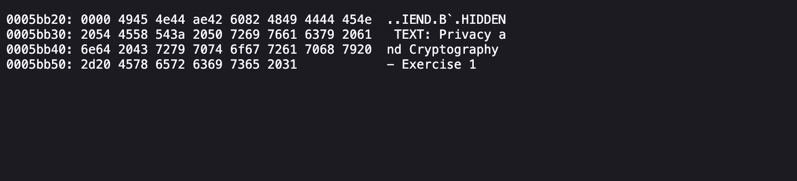

# Exercise 1 – Hiding a text in an image

[View Exercise 1 on GitHub](https://github.com/vivekkumar03/PRC/tree/main/exercise1)

**Task:** Hide a text of your choice in an image, attach the image (not embedded), screenshot the source of the image showing the text, and explain why hiding data in an image is possible.

## Files

| File | Purpose |
|---|---|
| `cover.png` | Original image (generated by `exercise1_stego.py generate`) |
| `stego.png` | Image with the text hidden in the pixels (LSB method) |
| `stego_hexvisible.png` | `stego.png` + the same kind of text appended after the PNG `IEND` chunk, so it shows in a hex dump |
| `exercise1_stego.py` | Generate / embed / extract script |
| `exercise1_diff.py` | Compares cover and stego image |
| `diff_amplified.png`, `stego_lsb_plane.png` | Evidence images produced by `exercise1_diff.py` |

Environment: macOS, Python 3 with Pillow (`pip3 install pillow`), `xxd`.

## Method

Two hiding techniques were used:

### 1. LSB steganography (hidden in the pixel data)
A PNG is lossless, so every pixel byte is preserved exactly. Each pixel has three bytes (R, G, B). The **least significant bit (LSB)** of each byte is replaced by one bit of the secret payload:

```
payload = "STEG" | length (4 bytes, big endian) | text (UTF-8)
for each bit i of payload:  channel_byte[i] = (channel_byte[i] & 0xFE) | bit_i
```

The magic marker `STEG` and the length let the extractor know where the message starts and ends.

Steps and commands (run inside `exercise1/`):

```bash
python3 exercise1_stego.py generate
python3 exercise1_stego.py embed "Privacy and Cryptography - Exercise 1: this secret is hidden in the pixels!"
python3 exercise1_stego.py extract
```

Output:

```
embedded 83 bytes (664 bits) into stego.png
Privacy and Cryptography - Exercise 1: this secret is hidden in the pixels!
```

The message (83 bytes with header) needs 664 bits, i.e. only the first 664 colour bytes (about the first 221 pixels, less than one image row of 800 px).

### 2. Appending data after the end of the PNG (visible in the source)
A PNG decoder stops at the `IEND` chunk and ignores anything after it. A text appended there is invisible in the image but easy to see in the file source:

```bash
cp stego.png stego_hexvisible.png
printf 'HIDDEN TEXT: Privacy and Cryptography - Exercise 1' >> stego_hexvisible.png
xxd stego_hexvisible.png | tail -4
```

Output:

```
0005bb20: 0000 4945 4e44 ae42 6082 4849 4444 454e  ..IEND.B`.HIDDEN
0005bb30: 2054 4558 543a 2050 7269 7661 6379 2061   TEXT: Privacy a
0005bb40: 6e64 2043 7279 7074 6f67 7261 7068 7920  nd Cryptography 
0005bb50: 2d20 4578 6572 6369 7365 2031            - Exercise 1
```

`49 45 4e44` is `IEND`; the text follows directly after its CRC (`ae42 6082`). The LSB-hidden text cannot be read in a hex dump (it is spread over single bits), which is why the second method is used for the "show the occurrence of the text" requirement. The image still opens normally.

The following screenshot shows the actual `xxd` output opened as text in Firefox. Submit `stego_hexvisible.png` as a separate image attachment, not embedded in this document.



## Results and interpretation

`cover.png` and `stego.png` appear identical in normal viewing, although their pixels and files differ:

```
$ python3 exercise1_diff.py
pixels changed: 202 of 480000
max change per channel: 1 (out of 255)
```

- Only 202 of 480,000 pixels changed (the others already had the right LSB value), each channel by at most 1/255.
- MD5 differs: `cover.png` = `8e35533365533269d0073baab559ffdc`, `stego.png` = `2ed271da3f879e4ffb9d9d4429006944`.
- `diff_amplified.png` marks the changed pixels in white (all in the top row); `stego_lsb_plane.png` shows the LSB plane.
- The extractor recovers the exact text, proving the data is inside the pixels.

### Pitfalls
- Lossy JPEG compression is likely to destroy the LSB message. PNG preserves pixels losslessly.
- Resizing, screenshotting, or re-encoding that changes pixels can destroy the LSB data. A lossless re-encoding that preserves pixel values can preserve it, but might discard trailing bytes.
- Without a length header/marker the extractor would not know where the text ends.

## Why is it possible to hide data inside an image?

1. **Perceptual redundancy:** A ±1 change in an 8-bit colour channel is usually difficult to notice, although invisibility is not guaranteed.
2. **Natural noise:** Some photographs contain sensor noise that can help mask changes, but statistical steganalysis may still detect altered LSBs.
3. **Large capacity:** A W×H RGB image offers W·H·3 bits. This 800×600 image can hold 1,440,000 bits ≈ 180 KB at 1 bit per byte.
4. **File format structure:** Formats have regions that decoders ignore (data after `IEND` in PNG or `FFD9` in JPEG, metadata/ancillary chunks, comment fields). Extra data there does not change the displayed image.
5. **Integrity limits:** PNG chunks have CRCs that detect corruption, but these are not cryptographic proof that an image is original; trailing bytes are outside the PNG chunks. A comparison or steganalysis can reveal changes.

Because the image looks unchanged, the existence of the message is hidden (steganography), unlike encryption which only hides the content. For real use, the text should additionally be encrypted before embedding.
