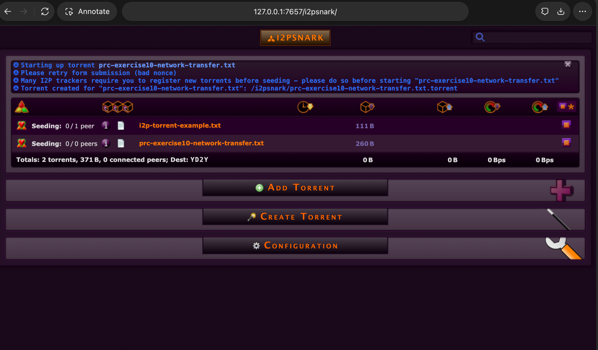
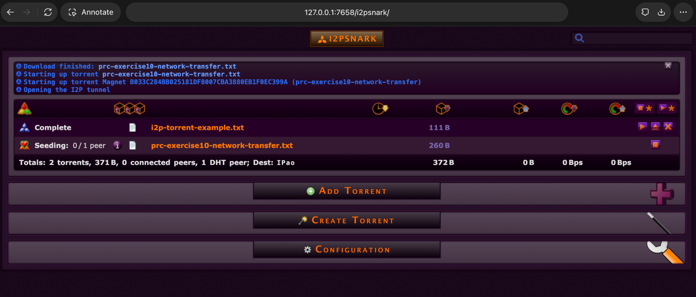
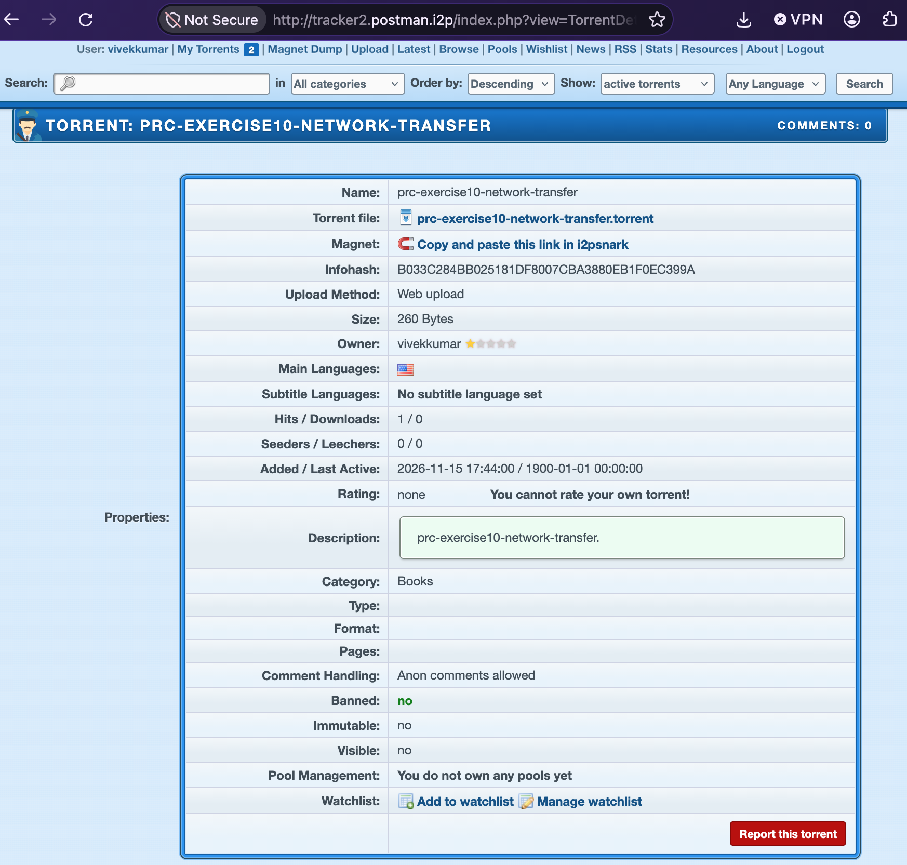

# Exercise 10: I2P Torrenting and Privacy

**Privacy and Cryptography · 15 November 2026**

## Objective

Transfer a small test file from the Exercise 9 publisher to the Exercise 10 recipient through the I2P torrent workflow, using I2PSnark and the Postman tracker. Confirm the received bytes by comparing SHA-256 digests, then relate the exercise to the privacy properties and limitations of I2P, Tor, and BitTorrent.

## Environment and setup

The publisher file was created in the Exercise 9 container. The publisher and recipient I2PSnark interfaces used separate host ports.

| Component | Observed / used |
|---|---|
| Publisher | Exercise 9 I2P container: `exercise9-i2p-1`; I2PSnark at `http://127.0.0.1:7657/i2psnark/`. |
| Recipient | Second local Docker container used as the Exercise 10 recipient: `exercise10-recipient-1`; I2PSnark at `http://127.0.0.1:7658/i2psnark/`. The Exercise 9 publisher was a separate local container. |
| Tracker | Postman I2P tracker at `tracker2.postman.i2p`, opened in the I2P-enabled browser. The torrent was submitted through the tracker's web upload. |
| Data file | `prc-exercise10-network-transfer.txt`, 260 bytes, stored under `/i2psnark/` in the publisher and recipient containers. |
| Torrent identifier | Infohash `B033C284BB025181DF8007CBA3880EB1F0EC399A`. |
| Local tools | Docker commands were run from the host terminal to inspect the containers and calculate SHA-256. |

## Practical workflow

### Publisher: Exercise 9

1. Created `prc-exercise10-network-transfer.txt` in the publisher container under `/i2psnark/`. The recorded content identifies it as a new test file intended for the recipient to obtain through the I2P torrent network; its size was 260 bytes.
2. Opened the Exercise 9 I2PSnark interface on port 7657 and used **Create Torrent** with `/i2psnark/prc-exercise10-network-transfer.txt`. The first form submissions produced “bad nonce” messages; after refreshing and retrying, the torrent metadata was created. This was an observed setup pitfall, not evidence of a transfer failure.
3. Copied the generated `.torrent` metadata file from the container to the host for tracker registration. The recorded command was:

   ```bash
   docker cp exercise9-i2p-1:/i2psnark/prc-exercise10-network-transfer.txt.torrent ~/USTP/PRC/exercise10/transfer-test/
   ```

4. Uploaded the `.torrent` metadata to Postman before starting the new torrent. The registration detail showed name `prc-exercise10-network-transfer`, owner `vivekkumar`, size 260 Bytes, upload method Web upload, and infohash `B033C284BB025181DF8007CBA3880EB1F0EC399A`. At registration the tracker listed 0 seeders and 0 leechers.
5. Returned to Exercise 9 I2PSnark and started the new torrent so the publisher could seed it. The interface listed the 260-byte transfer torrent alongside an earlier 111-byte example torrent. The screenshot recorded 0 connected peers; this is consistent with no currently connected peer being shown, not proof that the swarm was unavailable.



*Figure 1. Exercise 9 I2PSnark lists the 260-byte torrent. The interface shows 0 connected peers in this capture.*

### Recipient: Exercise 10

6. Opened the registered Postman detail page for `prc-exercise10-network-transfer` and copied its magnet link.
7. Opened the Exercise 10 I2PSnark interface on port 7658. Chose **Add Torrent**, pasted the magnet link, and submitted it. The recipient then displayed the matching torrent name and infohash.
8. Allowed I2PSnark to process the torrent. The interface ultimately displayed “Download finished” for `prc-exercise10-network-transfer.txt` and showed a size of 260 B.
9. Inspected the recipient file and compared its SHA-256 digest with the publisher copy.



*Figure 2. Exercise 10 I2PSnark reports “Download finished” for the 260-byte file. The capture shows 0 connected peers and 1 DHT peer.*

## Host terminal verification

The recipient file was listed as 260 bytes. The recorded commands were:

```bash
docker exec exercise10-recipient-1 ls -lh /i2psnark/prc-exercise10-network-transfer.txt
docker exec exercise10-recipient-1 sha256sum /i2psnark/prc-exercise10-network-transfer.txt
docker exec exercise9-i2p-1 sha256sum /i2psnark/prc-exercise10-network-transfer.txt
```

Both files had the SHA-256 digest:

```text
dd47b346b3ec0a9f9dd16f2b4a5211352cd4d229b58e3b9275a7ff1fcfd203c6
```

A matching SHA-256 digest is strong evidence that both local files contain identical bytes, subject to the usual negligible collision probability. Combined with the recipient’s “Download finished” status, this supports successful completion of the transfer workflow. It does not identify the exact relay or peer path, independently authenticate the publisher, or prove that the tracker supplied content.

| Check | Observed result |
|---|---|
| Recipient file size | 260 bytes (`260` in `ls -lh`; I2PSnark displayed 260 B). |
| Recipient SHA-256 | Matches the publisher's digest. |
| Publisher SHA-256 | Matches the recipient's digest. |

## Observed results and evidence boundaries

The observed 0-peer count is a momentary interface view and does not exclude a brief earlier peer exchange, another routing state, or data obtained through a path not exposed by the screenshot. Conversely, “Download finished” and matching file hashes do not reveal that path. The most defensible result is content-level completion supported by the client status and independent local hash comparison, with network-path details unresolved.

| Statement | Evidence status |
|---|---|
| Postman registration: owner `vivekkumar`, infohash `B033C284BB025181DF8007CBA3880EB1F0EC399A`, size 260 bytes. | Directly shown in the registration detail evidence. |
| Recipient I2PSnark displayed “Download finished” for the 260-byte torrent. | Directly shown in the recipient interface evidence. |
| Publisher and recipient SHA-256 values matched. | Reported from terminal commands on both containers. |
| Recipient I2P router was fully ready / network status was OK. | Not demonstrated. The recipient showed **Network: Testing**. |
| A direct publisher-to-recipient peer connection was observed. | Not demonstrated. Relevant screenshots showed **0 connected peers / 1 DHT peer**. |
| The completed file came from a particular peer or route. | Not established by the available interface and checksum evidence. |

## Limitations and caveats

- A file hash checks byte equality, not authorship or safety. Without a trusted signature or independently verified publisher key, a matching file could still be consistently wrong or malicious.
- Tracker registration records torrent metadata and swarm information; it is not a content-integrity authority and does not itself prove that the tracker relayed the file.
- I2PSnark peer and DHT counts are snapshots. A screenshot cannot establish all transient connections during a transfer.
- “Network: Testing” means the recipient router had not shown a confirmed ready status in the captured view. The transfer result should not be used to claim the router was fully healthy or that all I2P connectivity checks passed.
- The sample is only 260 bytes. It verifies a small-file workflow, not throughput, scalability, robustness under interruption, or resistance to traffic analysis.
- The first 111-byte `i2p-torrent-example.txt` was an initial workflow test and is not the primary Exercise 10 result. The 260-byte file and its infohash are the final transfer evidence.

## How does an I2P torrent differ from a clearnet torrent?

The BitTorrent concepts remain similar: a torrent identifies content and peer availability is discovered through tracker and/or DHT mechanisms. The main difference is the network on which discovery and peer communication take place. A clearnet torrent uses ordinary Internet addresses and public Internet reachability; a torrent client can expose a user’s IP address to other peers and possibly to trackers. An I2P torrent uses I2P destinations and I2P transport, so participating clients communicate within the I2P overlay rather than through publicly routable peer IP addresses. The Postman tracker used here is an I2P service, and the magnet metadata identifies the torrent through its infohash while I2PSnark locates peers in its configured I2P environment.

I2P provides layered routing within its own network and is designed primarily for services and communication inside that overlay. This brings a different address model, peer population, reachability, and performance profile from clearnet BitTorrent. I2P does not automatically make the user anonymous against every observer: endpoints, timing, volume, application behavior, misconfiguration, malicious peers, and correlation remain relevant. A clearnet torrent does not become an I2P torrent merely because the same BitTorrent protocol is used; the peer and tracker paths must actually use I2P.

## Can BitTorrent run over Tor? Why is it discouraged or difficult?

BitTorrent can be configured to use Tor in some client and network arrangements, but ordinary peer-to-peer torrenting is a poor fit for Tor. Many BitTorrent clients use UDP for DHT, peer discovery, and transport features, while Tor’s standard circuits carry TCP streams. Tor does not provide general UDP forwarding, so clients may fall back to direct connections or lose important discovery features unless carefully configured. If any tracker, DHT, peer, or auxiliary connection escapes the Tor path, the user’s public IP can be exposed. Peer-to-peer traffic also creates many long-lived, high-volume connections; this can consume scarce Tor capacity and make timing/volume correlation easier. Exit nodes may see unencrypted traffic when the application layer does not encrypt it, and a Tor exit is not a general shield against malicious content or identity leakage.

Tor is a low-latency anonymity network designed to support interactive TCP applications and access to both onion services and the clearnet. Routing a bulk P2P swarm through Tor can burden the network and offers weaker guarantees than users often assume. A user who chooses to experiment must bind the client to the intended proxy/interface, disable paths that bypass it, understand UDP limitations, avoid exposing a real IP through DHT or tracker connections, and check the client’s behavior. The safer course is to avoid using public Tor exit paths for BitTorrent; use a network designed for internal P2P traffic or a properly configured privacy solution whose policies and limitations are understood.

## What privacy and anonymity risks remain?

Anonymity is not a single property guaranteed by encryption. In torrenting, the infohash, tracker queries, peer lists, connection timing, transfer volume, and a distinctive download can reveal interests or link activity over time. A tracker can log registrations and announces; peers can observe the destination identity or address visible within their network. In I2P, the overlay obscures ordinary IP addresses from peers but does not prevent correlation by a sufficiently capable observer, malicious or compromised infrastructure, application-level identifiers, or a user who accidentally downloads through clearnet.

Other risks include reused usernames, account logins, browser cookies, file metadata, identifying text embedded in a shared file, unsafe client configuration, DNS or proxy leaks, compromised endpoints, malware, and traffic analysis. Encryption protects content in transit only for the layers and links where it is applied; it does not hide all metadata. Small swarms and rare files can be more identifying because fewer users share the same activity. Privacy therefore depends on the whole setup and behavior, not merely selecting an I2P or Tor option.

## When are torrents useful for legal distribution?

Torrents are useful for distributing large, legitimate files to many recipients without requiring one central server to supply every byte. Examples include Linux and other operating-system images, public-domain or openly licensed media, research datasets, and software released by its publisher. Peer-assisted distribution can reduce the origin server’s bandwidth load and improve availability when many users participate. The Exercise 10 test applies the same basic distribution model to a small text file.

For software updates and OS images, users should obtain torrent links from the official publisher, verify signed checksums or signatures published through a trusted channel, and verify the file after downloading. A torrent’s internal piece hashes detect accidental corruption relative to the torrent metadata, but do not prove who created that metadata. HTTPS, signed release manifests, and publisher signatures help establish authenticity; a standalone checksum copied from an untrusted source does not. Users should also respect copyright, license terms, and applicable law. The protocol is neutral: legality depends on the content and authorization to distribute it.

## What are the main differences between Tor and I2P?

Both use layered routing to make it harder for a single network point to associate a user with a destination, and neither is a guarantee of perfect anonymity. Their architecture and default network scope differ, so choosing between them depends on whether the goal is access to public Internet services, onion services, or services inside I2P.

| Aspect | Tor | I2P |
|---|---|---|
| Network purpose | Supports access to the public Internet through exit relays and access to onion services. | Primarily a self-contained overlay for communication and services within I2P. |
| Routing model | Onion routing through circuits, commonly with entry, middle, and exit relays for clearnet access. | Garlic routing and separate inbound/outbound tunnels, with traffic kept inside the overlay for I2P services. |
| Address/service model | Onion services use `.onion` names; clearnet browsing may exit to public sites. | I2P destinations and naming are used for internal services; reaching clearnet generally requires an outproxy. |
| Typical use distinction | Useful when an application needs private access to clearnet services or onion services. | Useful for services and peer communication intended to remain inside the I2P network. |
| Caveats | Exit traffic to clearnet can be observed at the exit if not protected end-to-end; application leaks remain possible. | Smaller overlay and service reachability can affect performance; correlation, endpoint, and configuration risks remain. |

## Evidence screenshots

The workflow captures are embedded in this report:

- **Publisher (Figure 1):** Exercise 9 I2PSnark lists the 260-byte torrent in a seeding state, with 0 connected peers visible in that capture.
- **Recipient (Figure 2):** Exercise 10 I2PSnark shows “Download finished,” 260 B, 0 connected peers, and 1 DHT peer.
- **Tracker (Figure 3):** Postman detail page shows the torrent name, owner `vivekkumar`, size 260 bytes, and registered infohash.
- **Terminal verification:** The recipient size and matching SHA-256 values are recorded above.



*Figure 3. Postman registration detail: infohash, 260-byte size, and owner `vivekkumar`.*

## Conclusion

The practical result is supported by two independent observations: Exercise 10 I2PSnark reported “Download finished,” and the publisher and recipient copies of the 260-byte file had identical SHA-256 digests. The torrent was registered on Postman under owner `vivekkumar` with infohash `B033C284BB025181DF8007CBA3880EB1F0EC399A`. These facts support successful completion and byte-for-byte equality.
