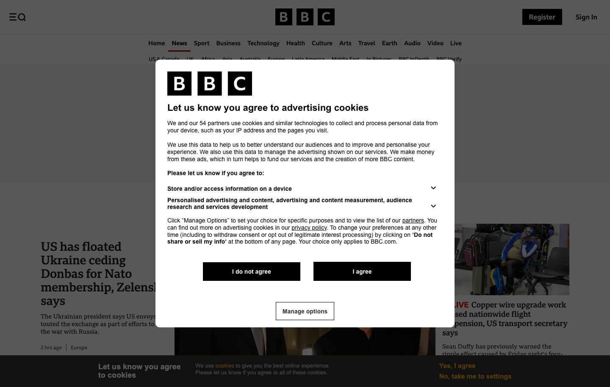
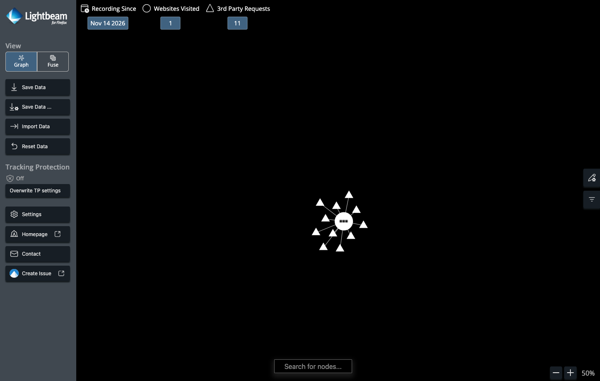
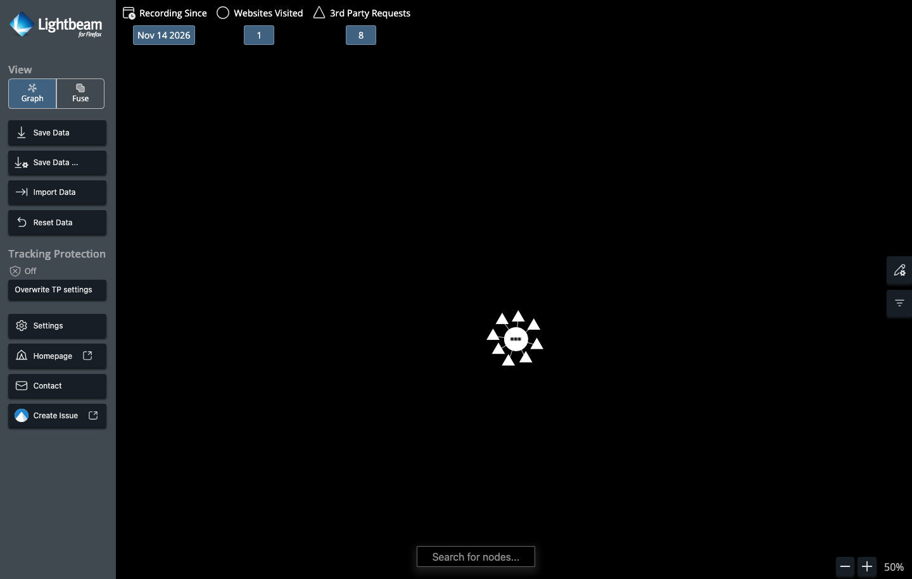

# Exercise 11: Lightbeam and Privacy Badger

## Method

On 14 November 2026 I visited [BBC News](https://www.bbc.com/news) in a
temporary, isolated Firefox 160 profile controlled by Selenium. I temporarily
installed Lightbeam 3.4.9 from Mozilla Add-ons, loaded the page for 20 seconds,
and opened Lightbeam. I then used Lightbeam's **Reset Data** button and
confirmed that the counts returned to zero, installed Privacy Badger
2026.9.15 from Mozilla Add-ons, revisited the same URL for 20 seconds, and
opened Lightbeam again. I did not select either option on BBC's advertising
cookie prompt. Lightbeam displayed its Tracking Protection indicator as
**Off** in both screenshots; this is Lightbeam's indicator, not proof that
every browser privacy protection was disabled.

## Results

Lightbeam showed one visited website in both visits, and its **3rd Party
Requests** counter changed from **11 to 8**. These numbers describe its
visualized third-party hosts, not necessarily the total number of individual
HTTP requests. The following hostnames were retrieved from Lightbeam's recorded
website data, not inferred from the picture.

| Observed host | Lightbeam only | With Privacy Badger |
|---|---|---|
| `cdn.privacy-mgmt.com` | Yes | Yes |
| `cdn.tinypass.com` | Yes | Yes |
| `emp.bbci.co.uk` | Yes | Yes |
| `gn-web-assets.api.bbc.com` | Yes | Yes |
| `ichef.bbci.co.uk` | Yes | No |
| `mybbc-analytics.files.bbci.co.uk` | Yes | Yes |
| `rm-script.dotmetrics.net` | Yes | No |
| `static.bbci.co.uk` | Yes | Yes |
| `static.files.bbci.co.uk` | Yes | Yes |
| `uk-script.dotmetrics.net` | Yes | No |
| `www.bbc.co.uk` | Yes | Yes |

The analytics- and measurement-looking hostnames are possible tracking
surfaces, but Lightbeam's graph shows connections, not proof that a particular
host tracked this person or set an identifying cookie. BBC-related asset
hosts can be classified as third-party relative to `www.bbc.com` without
being independent tracking companies. The observed difference is three fewer
hosts, including two Dotmetrics script hosts, not proof that Privacy Badger
blocked exactly those hosts: the test did not inspect its block decisions.

The same browser profile was reused after resetting Lightbeam, but browser
cache and cookies were not cleared. Dynamic site content, consent state,
network timing and Privacy Badger's pre-trained rules may affect the result.
One visit per condition cannot establish causation; repeat with controlled
fresh profiles and inspect Privacy Badger's per-site decisions for a stronger
comparison. Privacy Badger's learning updates and optional local learning
are described in its [FAQ](https://privacybadger.org/).

## Sources

- [Lightbeam for Firefox](https://addons.mozilla.org/en-US/firefox/addon/lightbeam-chikl/)
- [Privacy Badger for Firefox](https://addons.mozilla.org/en-US/firefox/addon/privacy-badger17/)
- [Privacy Badger FAQ](https://privacybadger.org/)
