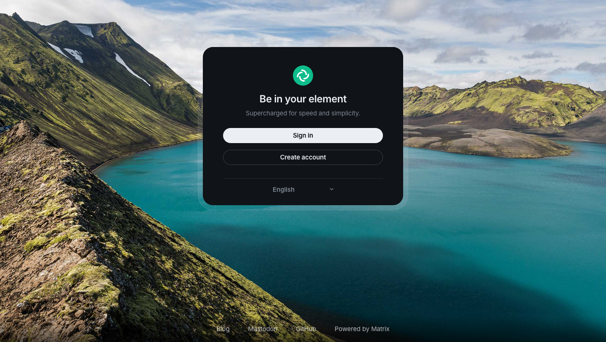
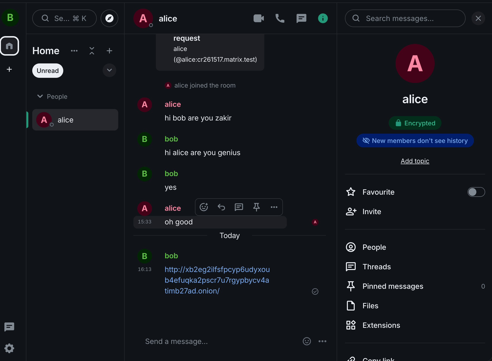

# Exercise 7 – Matrix server, federation, E2E, retention, bridge

[View Exercise 7 on GitHub](https://github.com/vivekkumar03/PRC/tree/main/exercise7)

**Task:** Run a Matrix server on a local domain containing the UAS ID, get chat and file sharing working, federate with a partner, document a chatroom with users from two homeservers, set retention (min 1 day, max 1 year) and E2E by default for new rooms, run the web client (Docker), bonus: a bridge.

**Limitations:** The second homeserver is a local simulation, not an independent partner. The API test used plaintext message events; an encrypted Element message and a real partner exchange were not verified. The lab configuration is not secure for public deployment.

## Setup overview

| Item | Value |
|---|---|
| Implementation | Synapse (`matrixdotorg/synapse`) in Docker |
| My homeserver | `cr261517.matrix.test` (container `hsA`, client port `8008`) |
| Partner homeserver | `partner.matrix.test` (container `hsB`, client port `8009`) – simulated partner on the same machine |
| Federation TLS | nginx (`federation-proxy`) on port 8448, self-signed cert, answers to both names inside the Docker network |
| Web client | Element Web, container `element`, <http://localhost:8080> (preconfigured for my server) |
| Bridge (bonus) | Heisenbridge (Matrix ⇄ IRC) as application service on `hsA` |

All files are in this folder: `docker-compose.yml`, `setup.sh`, `exercise_settings.yaml`, `nginx/nginx.conf`, `element/config.json`, `bridge/registration.yaml`, `test_federation.py`.

The local Element web client displayed its welcome screen during a later check:



An uploaded Element screenshot shows messages between Alice and Bob in a room
labelled **Encrypted**, including a shared onion address. It shows Alice's
full homeserver ID but not Bob's; it does not by itself establish the event
types or that Bob is an independent partner.



### Steps
1. `sh setup.sh` – generates `homeserver.yaml` + signing keys for both servers with `synapse generate`, applies the exercise settings, creates a self-signed certificate with SANs for both server names.
2. `docker compose up -d` – starts `hsA`, `hsB`, `federation-proxy`, `element`, `heisenbridge`.
3. Create users (shared-secret registration):

```bash
docker exec hsA register_new_matrix_user -u alice -p '<pw>' -a -c /data/homeserver.yaml http://localhost:8008
docker exec hsB register_new_matrix_user -u bob -p '<pw>' --no-admin -c /data/homeserver.yaml http://localhost:8008
```

4. Run `python3 test_federation.py` for the cross-server chat test below. For interactive use, open <http://localhost:8080> and log in as `@alice:cr261517.matrix.test`; for `bob` use "Edit" on the homeserver and `http://localhost:8009`.

### Configuration changes (`exercise_settings.yaml`, appended to `homeserver.yaml`)
```yaml
federation_verify_certificates: false      # lab only: self-signed certs
ip_range_whitelist: [172.16.0.0/12, 192.168.0.0/16, 10.0.0.0/8]   # allow federation to private Docker IPs
trusted_key_servers: []                    # no external key server in the lab

encryption_enabled_by_default_for_room_type: all   # enable encryption state for new rooms

retention:
  enabled: true
  default_policy:
    min_lifetime: 1d
    max_lifetime: 1y
  allowed_lifetime_min: 1d
  allowed_lifetime_max: 1y
```
Bridge (only on `hsA`):
```yaml
app_service_config_files:
  - /bridge/registration.yaml
```

## Pitfalls encountered
- **`.local` domain does not federate:** my first attempt used `*.matrix.local`. Synapse looks up the SRV record `_matrix-fed._tcp.<domain>`; for `.local` (mDNS) the resolver returned **SERVFAIL** instead of NXDOMAIN, so Synapse treated the server as unreachable (`502 Can't connect to server`, `DNSServerError rCode=2` in the log). Switching to the reserved TLD `.test` (clean NXDOMAIN → fallback to port 8448) fixed it. The UAS ID is still part of the name.
- **Private IPs are blocked by default:** Synapse refuses federation to RFC1918 addresses; `ip_range_whitelist` was needed for the Docker network.
- **Federation requires HTTPS:** Synapse only speaks TLS to other homeservers, so plain `8008` is not enough. nginx terminates TLS on 8448 (self-signed, therefore `federation_verify_certificates: false`; with a real domain use a Let's Encrypt cert and keep verification on).
- Docker Desktop was not running at first (`Cannot connect to the Docker daemon`).

## Result: working chatroom with two homeservers

Output of `python3 test_federation.py` (alice on `cr261517.matrix.test` creates a room, invites `bob` on `partner.matrix.test`):

```
room: !6C3RxfSHISHiUD9oSh3xXi2A-Jbx4f1qoyHateKO6XE
m.room.encryption state (default for new rooms): {'algorithm': 'm.megolm.v1.aes-sha2'}
bob (partner.matrix.test) joined
file uploaded: mxc://cr261517.matrix.test/frKTZVvzWoWFZgIkVaZCkEAI
members seen from partner server: ['@alice:cr261517.matrix.test', '@bob:partner.matrix.test']
  @bob:partner.matrix.test -> m.room.message hello back from partner.matrix.test
  @alice:cr261517.matrix.test -> m.room.message hello from cr261517.matrix.test
  @alice:cr261517.matrix.test -> m.room.message hello.txt
```

Interpretation:
- The room was created on server A, bob's server B accepted the invite and joined through the federation API (TLS on 8448); members from both servers are in the room → **federation works**.
- The new room automatically has `m.room.encryption` (`m.megolm.v1.aes-sha2`), demonstrating the default encryption state. The test script sends plaintext through the raw API and does **not** verify end-to-end encrypted messaging; an encryption-capable client test is still needed.
- The file uploaded to server A was downloaded by bob from **his own** server B (`curl .../_matrix/client/v1/media/download/cr261517.matrix.test/frKTZVvzWoWFZgIkVaZCkEAI` returned `file shared over federation`), i.e. B fetched the media from A over federation → **file sharing works**.
- Retention is configured as shown. Synapse applies its default policy when a room has no policy; the allowed limits adjust the effective `max_lifetime` used by purge jobs rather than preventing room admins from setting other values. Synapse records `min_lifetime` but does not otherwise implement it. Purges are asynchronous and do not cover state events. Actual expiration and deletion were not observed; see [Synapse retention documentation](https://matrix-org.github.io/synapse/latest/message_retention_policies.html).

### Remaining verification
The screenshot shows a two-user conversation and an encrypted-room indicator, but does not independently verify the message event types or show both full homeserver IDs. Audio/video was not tested. An independent partner and reachable LAN or public deployment are still required for the partner test.

## Bonus: bridge (Heisenbridge, Matrix ⇄ IRC)
1. `docker run --rm -v $PWD/bridge:/data hif1/heisenbridge -c /data/registration.yaml --generate -l heisenbridge -p 9898` creates the appservice registration (namespace `@irc_.*`).
2. Registration file mounted into `hsA` and listed in `app_service_config_files`; the `heisenbridge` container runs with owner `@alice:cr261517.matrix.test`.
3. Alice opened a DM with `@heisenbridge:cr261517.matrix.test` and sent `HELP`:

```text
@heisenbridge:cr261517.matrix.test : Howdy, stranger! You have been granted access to the IRC bridge of cr261517.matrix.test.
@heisenbridge:cr261517.matrix.test : Following commands are supported:
    NETWORKS - list available networks
    SERVERS  - list servers for a network
    OPEN     - open network for connecting
    STATUS   - show bridge status ...
```

The bridge responded. Connecting to an actual IRC network (`OPEN libera`) was not done here. A bridge must have access to the content it forwards, so end-to-end confidentiality does not extend across the IRC bridge.

## Moving to a real partner (LAN/WAN)
- Pick real names (e.g. `<uasid>.<your-domain>`) with DNS A records (or a `_matrix-fed._tcp` SRV record) pointing to the host; open TCP 8448 (or serve `/.well-known/matrix/server` on 443).
- Use a valid certificate (Let's Encrypt) and remove `federation_verify_certificates: false` and the IP whitelist.
- Check with the Matrix Federation Tester; then invite `@partner:their.domain` to a room.

## Cleanup
`docker compose down` (add `-v` not needed; data lives in `hsA/`, `hsB/`). Test credentials are lab-only.
