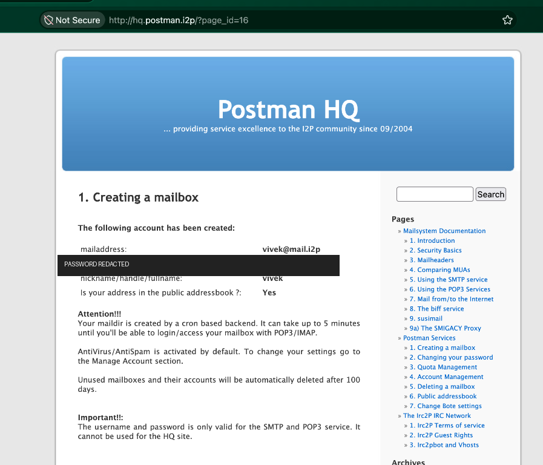
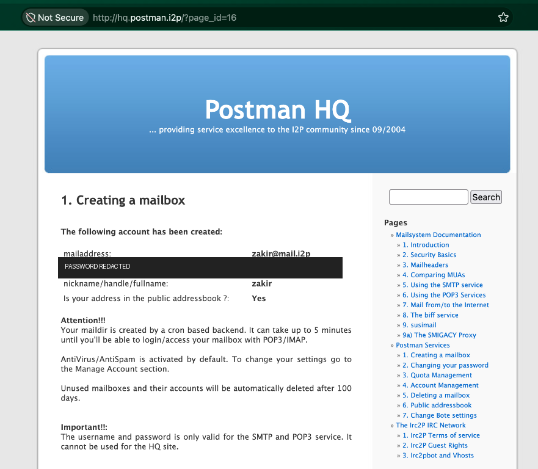
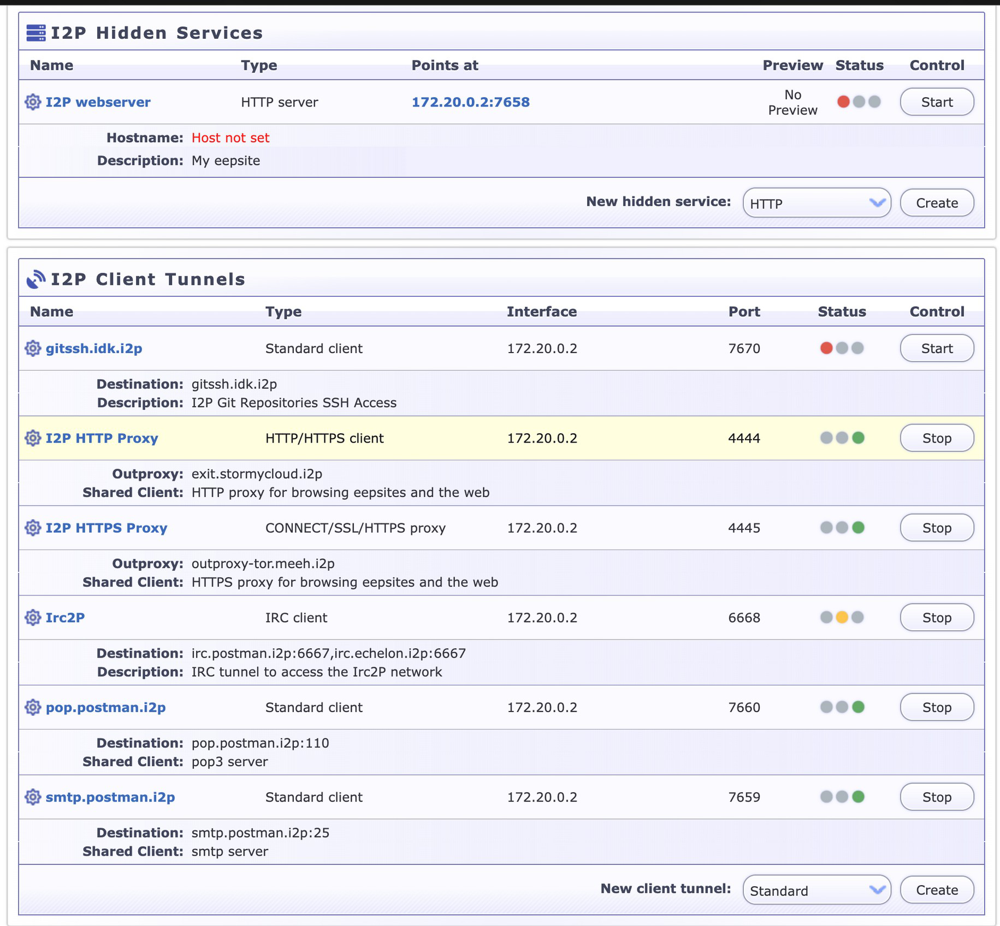
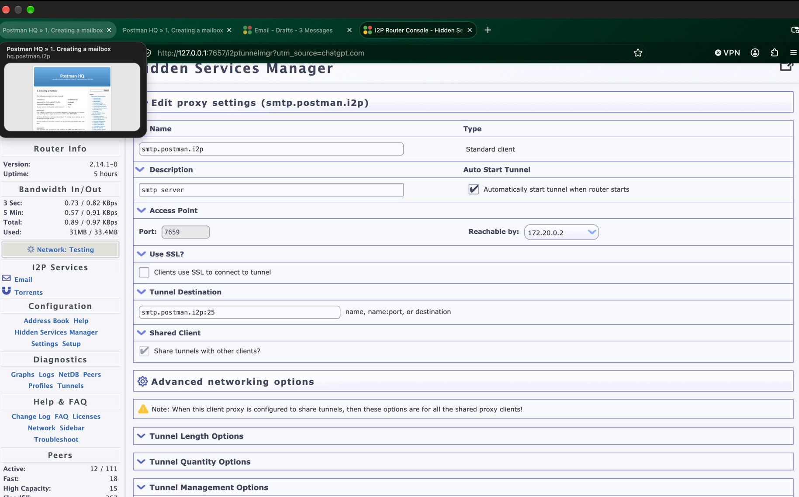
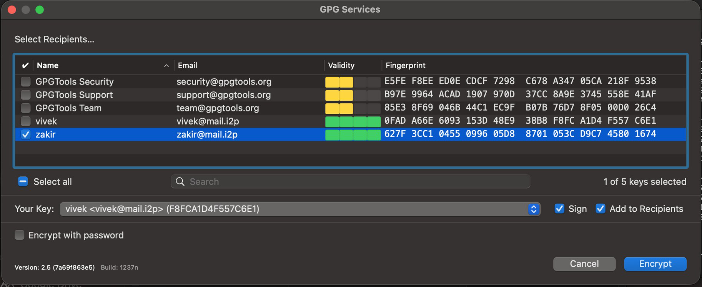
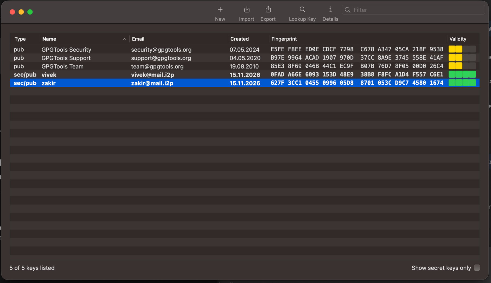
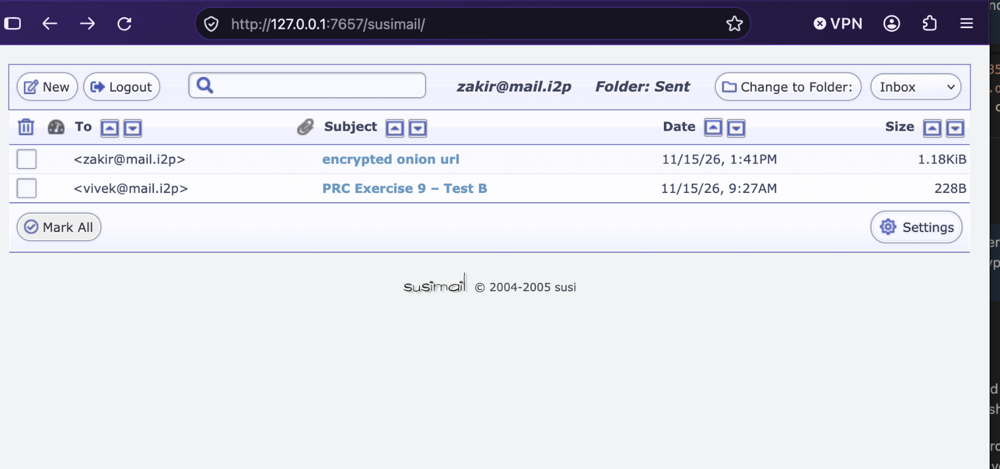
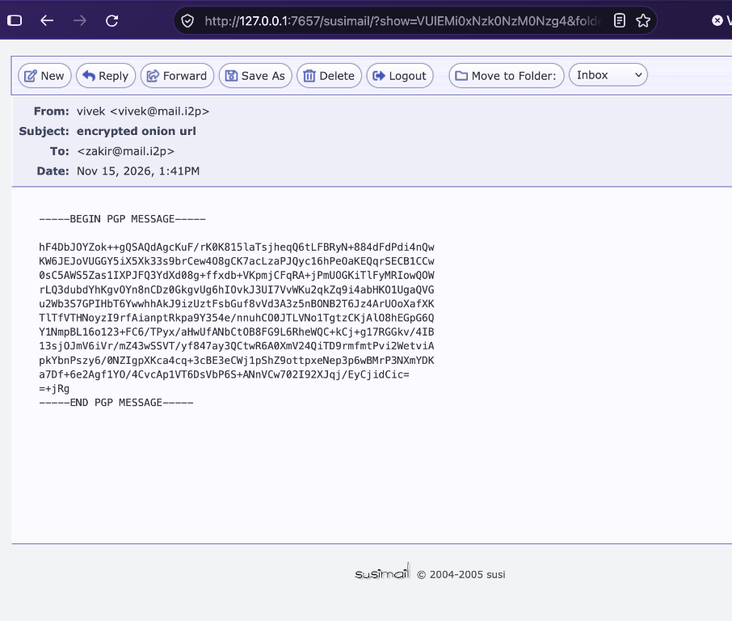
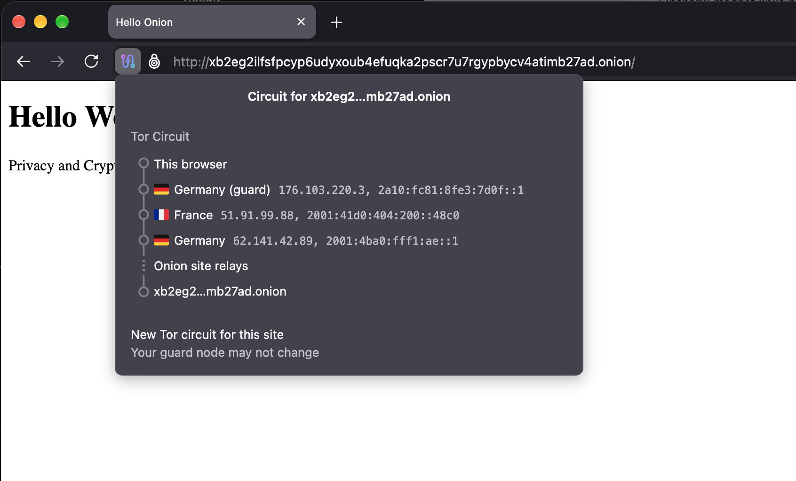

# Exercise 9 – I2P Email and OpenPGP

[View Exercise 9 on GitHub](https://github.com/vivekkumar03/PRC/tree/main/exercise9)

**Privacy and Cryptography · 15 November 2026**

## Objective

Create I2P email accounts and OpenPGP keys, send an encrypted onion-service
address to a recipient, and open it using Tor Browser. The two email
identities were `vivek@mail.i2p` and `zakir@mail.i2p`.

## Setup

The I2P router provided the Postman email tunnels: SMTP on local port `7659`
and POP3 on `7660`. The I2P HTTP proxy used local port `4444`. These services
were kept on the local machine.

I created the two mailboxes on Postman HQ through the I2P HTTP proxy. The
confirmation pages show the resulting `vivek@mail.i2p` and `zakir@mail.i2p`
addresses. Passwords are redacted from these screenshots.

Separate OpenPGP key pairs were created for the two email identities. The
keychain screenshot shows both keys.

I uploaded the exported public key to [keys.openpgp.org](https://keys.openpgp.org/).
Only the public key is published; the private key stays in the local keychain.
The I2P email screenshots show the armored encrypted onion-address message,
not an attached `.asc` public-key file. The key publication and the encrypted
email exchange were separate steps.

## Sending, encryption, and decryption

Thunderbird was tried but did not work for this email workflow. I then used
GPGTools/GnuPG manually to encrypt and sign the onion address for the
recipient, and to decrypt and verify it. GnuPG reported a **good signature
from Zakir's key**. The resulting armored OpenPGP message was sent through
SusiMail.

The sender's Sent-folder screenshot shows the encrypted message addressed to
Zakir. The recipient-side screenshots show Zakir's SusiMail account and the
opened message from Vivek containing the armored PGP message.

## Opening the onion service

After decryption, Tor Browser opened the onion service, displaying the
“Hello Onion” page. The screenshot includes the onion address and Tor relay
IP addresses. The relay details describe this captured session and may change
with a different circuit.

## Results and learning

- I2P provided the email transport; Tor Browser accessed the onion service.
  These are separate networks with different purposes.
- OpenPGP encrypts message content and allows signature verification. GnuPG
  reported a good signature associated with Zakir's key.
- OpenPGP does **not** hide ordinary email headers such as sender, recipient,
  date, or subject. The subject can reveal the message's purpose, so avoid
  sensitive details there.
- Publishing a public key to multiple keyservers is not required if the
  recipient can obtain it reliably. Multiple servers may improve
  discoverability, but fingerprint verification through a trusted channel
  is still needed to confirm whose key it is.

## Sources

- [I2P Docker image](https://hub.docker.com/r/geti2p/i2p)
- [I2P browser configuration](https://i2p.net/en/docs/guides/browser-config/)
- [OpenPGP key publication guidance](https://keys.openpgp.org/about/usage/)
