# Exercise 1 – Hiding a text in an image

[View Exercise 1 on GitHub](https://github.com/vivekkumar03/PRC/tree/main/exercise1)

**Task:** Hide a text of your choice in an image, attach the image (not embedded), screenshot the source of the image showing the text, and explain why hiding data in an image is possible.

## Files

| File | Purpose |
|---|---|
| `cover.png` | Original image (generated by `exercise1_stego.py generate`) |
| `stego.png` | Image with the text hidden in the pixels (LSB method) |
| `stego_hexvisible.png` | `stego.png` + the same kind of text appended after the PNG `IEND` chunk, so it shows in a hex dump |
| `exercise1_stego.py` | Generate / embed / extract script |
| `exercise1_diff.py` | Compares cover and stego image |
| `diff_amplified.png`, `stego_lsb_plane.png` | Evidence images produced by `exercise1_diff.py` |

Environment: macOS, Python 3 with Pillow (`pip3 install pillow`), `xxd`.

## Method

Two hiding techniques were used:

### 1. LSB steganography (hidden in the pixel data)
A PNG is lossless, so every pixel byte is preserved exactly. Each pixel has three bytes (R, G, B). The **least significant bit (LSB)** of each byte is replaced by one bit of the secret payload:

```
payload = "STEG" | length (4 bytes, big endian) | text (UTF-8)
for each bit i of payload:  channel_byte[i] = (channel_byte[i] & 0xFE) | bit_i
```

The magic marker `STEG` and the length let the extractor know where the message starts and ends.

Steps and commands (run inside `exercise1/`):

```bash
python3 exercise1_stego.py generate
python3 exercise1_stego.py embed "Privacy and Cryptography - Exercise 1: this secret is hidden in the pixels!"
python3 exercise1_stego.py extract
```

Output:

```
embedded 83 bytes (664 bits) into stego.png
Privacy and Cryptography - Exercise 1: this secret is hidden in the pixels!
```

The message (83 bytes with header) needs 664 bits, i.e. only the first 664 colour bytes (about the first 221 pixels, less than one image row of 800 px).

### 2. Appending data after the end of the PNG (visible in the source)
A PNG decoder stops at the `IEND` chunk and ignores anything after it. A text appended there is invisible in the image but easy to see in the file source:

```bash
cp stego.png stego_hexvisible.png
printf 'HIDDEN TEXT: Privacy and Cryptography - Exercise 1' >> stego_hexvisible.png
xxd stego_hexvisible.png | tail -4
```

Output:

```
0005bb20: 0000 4945 4e44 ae42 6082 4849 4444 454e  ..IEND.B`.HIDDEN
0005bb30: 2054 4558 543a 2050 7269 7661 6379 2061   TEXT: Privacy a
0005bb40: 6e64 2043 7279 7074 6f67 7261 7068 7920  nd Cryptography 
0005bb50: 2d20 4578 6572 6369 7365 2031            - Exercise 1
```

`49 45 4e44` is `IEND`; the text follows directly after its CRC (`ae42 6082`). The LSB-hidden text cannot be read in a hex dump (it is spread over single bits), which is why the second method is used for the "show the occurrence of the text" requirement. The image still opens normally.

The following screenshot shows the actual `xxd` output opened as text in Firefox. Submit `stego_hexvisible.png` as a separate image attachment, not embedded in this document.

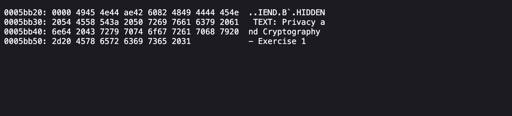

## Results and interpretation

`cover.png` and `stego.png` appear identical in normal viewing, although their pixels and files differ:

```
$ python3 exercise1_diff.py
pixels changed: 202 of 480000
max change per channel: 1 (out of 255)
```

- Only 202 of 480,000 pixels changed (the others already had the right LSB value), each channel by at most 1/255.
- MD5 differs: `cover.png` = `8e35533365533269d0073baab559ffdc`, `stego.png` = `2ed271da3f879e4ffb9d9d4429006944`.
- `diff_amplified.png` marks the changed pixels in white (all in the top row); `stego_lsb_plane.png` shows the LSB plane.
- The extractor recovers the exact text, proving the data is inside the pixels.

### Pitfalls
- Lossy JPEG compression is likely to destroy the LSB message. PNG preserves pixels losslessly.
- Resizing, screenshotting, or re-encoding that changes pixels can destroy the LSB data. A lossless re-encoding that preserves pixel values can preserve it, but might discard trailing bytes.
- Without a length header/marker the extractor would not know where the text ends.

## Why is it possible to hide data inside an image?

1. **Perceptual redundancy:** A ±1 change in an 8-bit colour channel is usually difficult to notice, although invisibility is not guaranteed.
2. **Natural noise:** Some photographs contain sensor noise that can help mask changes, but statistical steganalysis may still detect altered LSBs.
3. **Large capacity:** A W×H RGB image offers W·H·3 bits. This 800×600 image can hold 1,440,000 bits ≈ 180 KB at 1 bit per byte.
4. **File format structure:** Formats have regions that decoders ignore (data after `IEND` in PNG or `FFD9` in JPEG, metadata/ancillary chunks, comment fields). Extra data there does not change the displayed image.
5. **Integrity limits:** PNG chunks have CRCs that detect corruption, but these are not cryptographic proof that an image is original; trailing bytes are outside the PNG chunks. A comparison or steganalysis can reveal changes.

Because the image looks unchanged, the existence of the message is hidden (steganography), unlike encryption which only hides the content. For real use, the text should additionally be encrypted before embedding.

---

# Exercise 2: One round of AES-128

[View Exercise 2 on GitHub](https://github.com/vivekkumar03/PRC/tree/main/exercise2)

The plaintext is `buy me some potato chips please` and the key is
`keys are boring1`. Both are encoded as ASCII/UTF-8; the 16-byte key therefore
selects AES-128. The first 16-byte plaintext block is `buy me some pota`.
No padding is needed for this first block. The remaining 15 bytes would need
padding if a block mode requiring full blocks were used; for example, PKCS#7
adds one byte `01`.

All numbers below are hexadecimal. Each four-byte **column** of the matrix
is filled in order from the byte stream, as specified by AES. The AES
algorithm performs an initial AddRoundKey **before** round 1. This is included
here; the result shown is the state after one round, **not** a complete AES
ciphertext.

## Input and initial AddRoundKey

```text
First plaintext block (hex):
62 75 79 20 6d 65 20 73 6f 6d 65 20 70 6f 74 61

State                      Key (round 0)
62 6d 6f 70                6b 20 20 69
75 65 6d 6f                65 61 62 6e
79 20 65 74                79 72 6f 67
20 73 20 61                73 65 72 31

Initial AddRoundKey = State XOR Key
09 4d 4f 19
10 04 0f 01
00 52 0a 13
53 16 52 50
```

For example, the top-left entry is `62 XOR 6b = 09`.

## Round 1 key expansion

Split the original key into four words:

```text
w0 = 6b657973   w1 = 20617265   w2 = 20626f72   w3 = 696e6731
RotWord(w3) = 6e673169
SubWord(...) = 9f85c7f9
Rcon[1] = 01000000
g(w3) = 9e85c7f9
w4 = w0 XOR g(w3) = f5e0be8a
w5 = w1 XOR w4    = d581ccef
w6 = w2 XOR w5    = f5e3a39d
w7 = w3 XOR w6    = 9c8dc4ac
```

These words form the round 1 key, arranged in columns:

```text
f5 d5 f5 9c
e0 81 e3 8d
be cc a3 c4
8a ef 9d ac
```

## Round 1 transformations

**SubBytes:** apply the AES S-box to each byte. For example, `S(09) = 01`.

```text
01 e3 84 d4
ca f2 76 7c
63 00 67 7d
ed 47 00 53
```

**ShiftRows:** rotate rows 0, 1, 2 and 3 left by 0, 1, 2 and 3 positions.

```text
01 e3 84 d4
f2 76 7c ca
67 7d 63 00
53 ed 47 00
```

**MixColumns:** multiply each column by the AES matrix in the field
GF(2^8), using the reduction polynomial `x^8 + x^4 + x^3 + x + 1`:

```text
02 03 01 01
01 02 03 01
01 01 02 03
03 01 01 02
```

For the first output byte, `02·01 XOR 03·f2 XOR 67 XOR 53 = 3b`;
field multiplication gives `03·f2 = 0d`. Applying this to all columns:

```text
3b d7 b3 f6
04 65 9e 5b
c8 43 f7 1e
30 f4 06 ad
```

**AddRoundKey:** XOR with the round 1 key:

```text
ce 02 46 6a
e4 e4 7d d6
76 8f 54 da
ba 1b 9b 01
```

Reading columns in order, the **one-round state** is:

```text
ce e4 76 ba 02 e4 8f 1b 46 7d 54 9b 6a d6 da 01
```

## Check and interpretation

The implementation used for the calculation was checked against the NIST
AES-128 test vector and against a complete AES-128-ECB encryption using
OpenSSL via Node.js. The full encryption of this one block, used only as a
check, is `f3d7e0fa0d0892f0ac7938e0d76629ff`; it is not the one-round
answer. Real encryption requires all AES rounds and a suitable authenticated
mode such as AES-GCM; ECB is used only for this single-block check.

Source: [NIST FIPS 197: Advanced Encryption Standard](https://csrc.nist.gov/pubs/fips/197/final).

---

# Exercise 3: RSA Encryption

[View Exercise 3 on GitHub](https://github.com/vivekkumar03/PRC/tree/main/exercise3)

## Problem

Use the supplied RSA key pair to encrypt the integer message `99`. Show the calculation steps and intermediate results, explain how to handle the public and private keys, and describe which key is used for encryption, decryption, signing, and verification.

## Given Values

- Message: `m = 99`
- Modulus: `n = 187`
- Public exponent: `e = 7`
- Private exponent: `d = 23`
- Public key: `(e, n) = (7, 187)`
- Private key: `(d, n) = (23, 187)`

The modulus factors as `187 = 11 * 17`, so Euler's totient is:

```text
phi(n) = (11 - 1) * (17 - 1) = 160
```

The exponents form a valid pair because:

```text
e * d = 7 * 23 = 161 = 1 * 160 + 1
```

Thus `e * d` is congruent to `1` modulo `phi(n)`. Also, the message is in the valid range, `0 <= 99 < 187`.

## Encryption

RSA encryption uses the recipient's public key:

```text
c = m^e mod n = 99^7 mod 187
```

Use repeated squaring. First:

```text
99^2 = 9801 = 52 * 187 + 77
99^2 mod 187 = 77
```

Square that remainder to get the fourth power:

```text
99^4 mod 187 = 77^2 mod 187
             = 5929 mod 187
             = 132
```

Since `7 = 4 + 2 + 1`:

```text
99^7 mod 187 = (99^4 * 99^2 * 99) mod 187
              = (132 * 77 * 99) mod 187
```

Reduce the products as we go:

```text
132 * 77 = 10164 = 54 * 187 + 66
66 * 99  = 6534  = 34 * 187 + 176
```

Therefore, the ciphertext is:

```text
c = 176
```

## Decryption Check

The recipient applies the private exponent to the ciphertext:

```text
m = c^d mod n = 176^23 mod 187
```

Repeated squaring gives:

```text
176^1  mod 187 = 176
176^2  mod 187 = 121
176^4  mod 187 = 55
176^8  mod 187 = 33
176^16 mod 187 = 154
```

Because `23 = 16 + 4 + 2 + 1`, multiply the corresponding remainders:

```text
176 * 121 = 21296 = 113 * 187 + 165
165 * 55  = 9075  = 48 * 187 + 99
99 * 154  = 15246 = 81 * 187 + 99
```

The decrypted plaintext is `99`, which matches the original message. This confirms that the supplied key pair works for this example.

## Key Handling and Uses

The recommended practice is to publish the public key and protect the private key. A public key can be shared, but its owner should be authenticated (for example, with a trusted certificate or verified fingerprint) so an attacker cannot substitute a different key. The private key must remain secret and should be stored with access controls; never send it to people who need to send you encrypted messages.

| Operation | Key used | What it does |
| --- | --- | --- |
| Encrypt a message for the key owner | Recipient's public key `(e, n)` | Protects confidentiality; only the matching private key should decrypt it. |
| Decrypt a message | Recipient's private key `(d, n)` | Recovers a message encrypted for that recipient. |
| Create a digital signature | Signer's private key `(d, n)` | Binds the signer to data and helps detect changes. |
| Verify a digital signature | Signer's public key `(e, n)` | Checks that the signature matches the data and the corresponding public key. |

For this exercise, encryption is `c = m^e mod n`, and decryption is `m = c^d mod n`. The signature row describes the other common use of a key pair. In real systems, signatures are made over a hash using a signature scheme; they are not a way to keep a message secret.

## Calculator Program

The accompanying [exercise3_rsa.py](exercise3/exercise3_rsa.py) program accepts the values as command-line parameters, prints the repeated-squaring steps, calculates the ciphertext, and decrypts it as a round-trip check.

```bash
python3 exercise3/exercise3_rsa.py --message 99 --modulus 187 --public-exponent 7 --private-exponent 23
```

For these values, it reports ciphertext `176`, decrypted plaintext `99`, and a passed round-trip check.

## Practical Note

These tiny values demonstrate the RSA calculation only; they are not secure. Real applications use well-vetted RSA implementations with secure padding, such as OAEP for encryption and PSS for signatures. RSA is commonly used to protect a symmetric key rather than to encrypt large messages directly.

---

# Exercise 4: European eID and trust architecture

[View Exercise 4 on GitHub](https://github.com/vivekkumar03/PRC/tree/main/exercise4)

The European eIDAS framework does not replace national identity schemes with
one universal identity provider. Member States notify their own schemes and,
subject to the regulation's conditions, recognise eligible notified schemes
from other countries for cross-border access to public services. The schemes
can use different technologies and trust arrangements; it is therefore
incorrect to assume that every national login uses an identical root-to-citizen
certificate hierarchy. In the eIDAS interoperability framework, national
nodes exchange authentication information between the service's country and
the user's country. This federation of national systems resembles a
web-of-trust **only as an analogy**: recognition is based on a legal framework,
notification, assurance requirements and institutional supervision, not
individuals freely signing one another's keys as in PGP. Separately, qualified
trust services such as electronic signatures use national trusted lists,
published by each country and made accessible by the European Commission;
the lists support validation of qualified services and should not be confused
with the authentication-node protocol.

A likely reason for this federated architecture is to achieve interoperability
while respecting national control of identity and building on existing
national systems, legislation and investments. It avoids requiring all
countries to replace their systems with a single technical design, but makes
reliable governance, compatible assurance levels and secure operation by each
participant essential. This explanation is an architectural interpretation,
not a claim that one compromised service can never affect other countries.

## Sources

- [European Commission: eIDAS regulation](https://digital-strategy.ec.europa.eu/en/policies/eidas-regulation)
- [European Commission: EU trusted lists](https://digital-strategy.ec.europa.eu/en/policies/eu-trusted-lists)
- [Regulation (EU) 2024/1183, European Digital Identity Framework](https://eur-lex.europa.eu/eli/reg/2024/1183/oj)

---

# Exercise 5: Consent under the GDPR

[View Exercise 5 on GitHub](https://github.com/vivekkumar03/PRC/tree/main/exercise5)

## Conditions for valid consent

Under GDPR Articles 4(11), 6(1)(a) and 7, consent must be **freely given,
specific, informed and unambiguous**, expressed by a clear affirmative act.
The controller must be able to demonstrate it. The person must know at least
who the controller is, the purposes, the relevant processing and their right
to withdraw. Requests must be intelligible, easily accessible and clearly
distinguishable from unrelated matters. A pre-ticked box, silence or inactivity
does not constitute consent. Separate choices are needed for distinct
purposes, and consent is not freely given if a person cannot genuinely refuse
or suffers a detriment for refusal; an unnecessary condition attached to a
contract can also undermine it.

Consent must be withdrawable **at any time**, as easily as it was given.
Withdrawal does not retrospectively make prior processing unlawful, but the
controller must stop consent-based processing unless another lawful basis
properly applies. Where Article 9 requires **explicit** consent for special
category data, the indication must be expressly stated; ordinary implied
conduct is not enough.

## Children

The GDPR does not create one universal age at which someone becomes an adult.
The UN Convention on the Rights of the Child generally defines a child as a
person under 18, unless majority is attained earlier under applicable law.
Children merit particular protection, and information addressed to them
should be in clear, child-appropriate language.

Article 8 creates a **specific digital-consent rule**, not a general rule for
all processing involving children. When consent is the legal basis for an
information-society service offered directly to a child, the default age is
16. A Member State may set a lower age, but not below 13. Below the applicable
age, consent or authorisation by a holder of parental responsibility is
required, and the controller must make reasonable efforts to verify it,
taking available technology into account. Article 8 does not displace
general national contract law. Other legal bases may apply when appropriate.

## When is consent needed?

Personal data processing must have a lawful basis under Article 6, but
**consent is only one possible basis**. Other bases include necessity for a
contract, a legal obligation, vital interests, a public task, or legitimate
interests subject to the applicable balancing test. A controller must select
and document the appropriate basis before processing; it cannot treat consent
as mandatory for every activity or as a substitute for the other GDPR duties.
Special-category data generally require both an Article 6 basis and an
applicable Article 9 exception, such as explicit consent. Separate rules,
including the ePrivacy rules and national implementation, may also require
consent for non-essential cookies.

## Sources

- [GDPR, Regulation (EU) 2016/679, Articles 4, 6–9 and Recitals 32 and 38](https://eur-lex.europa.eu/eli/reg/2016/679/oj)
- [UN Convention on the Rights of the Child, Article 1](https://www.ohchr.org/en/instruments-mechanisms/instruments/convention-rights-child)
- [EDPB Guidelines 05/2020 on consent](https://www.edpb.europa.eu/our-work-tools/our-documents/guidelines/guidelines-052020-consent-under-regulation-2016679_en)

---

# Exercise 6: Metadata, Privacy, and IPsec

[View Exercise 6 on GitHub](https://github.com/vivekkumar03/PRC/tree/main/exercise6)

## What Is Metadata?

Metadata is information about a communication rather than the communication's main content. Network metadata can include source and destination IP addresses, time and duration, packet size, frequency, volume, and sometimes ports or location-related information. For example, an observer might not be able to read an encrypted message but may still see which network endpoints exchanged traffic and when.

## Why Metadata Is Valuable

Metadata supports useful services. Network operators can use it to route traffic, diagnose outages, manage congestion, plan capacity, and detect unusual activity. Companies may analyze usage patterns to improve services, measure advertising, or personalize products. Government agencies may use records such as call details or location histories in investigations, subject to applicable law and oversight.

## Privacy Risks

Metadata can reveal sensitive information even without message content. Repeated records can expose a person's routines, relationships, workplace, medical visits, religious attendance, or political activity. Combining records from multiple services can make an apparently anonymous device or account identifiable. Risks grow when data is collected continuously, kept for a long time, shared with third parties, or used for purposes different from those a person expected. Such tracking can also chill lawful activity and expose people to discrimination, unwanted targeting, or physical harm.

Useful safeguards include collecting only what is needed, limiting retention, restricting access and onward sharing, using aggregation or effective de-identification where appropriate, and being transparent about collection and use. These measures reduce risk but do not make all metadata harmless.

## What Encryption Does and Does Not Hide

Encryption protects content from parties that do not have the relevant keys. It does not automatically hide all information needed to deliver network traffic. IPsec is a network-layer security architecture; its ESP protocol can encrypt packet contents, but what an observer can see depends on the mode:

- **Transport mode:** ESP protects the transport-layer payload. The IP header used to route the packet, including its source and destination addresses, remains visible to network intermediaries.
- **Tunnel mode:** ESP protects the complete inner IP packet, including its original addresses. A new outer IP header is added for delivery between the IPsec tunnel endpoints. Intermediaries can see those tunnel endpoint addresses, as well as traffic timing, size, and volume.

Thus, tunnel mode can conceal the original communicating hosts from an observer between the tunnel endpoints, but it does not make the communication invisible. The tunnel endpoints and services that create or retain logs may still know the original metadata. Packet padding and dummy traffic can reduce some traffic-analysis clues, but add overhead and do not guarantee that traffic patterns cannot be inferred. These distinctions follow the IPsec architecture described in [RFC 4301](https://www.rfc-editor.org/rfc/rfc4301), especially its sections on tunnel-mode headers and traffic-flow confidentiality.

## Examples

### Company: X-Mode Social / Outlogic

In January 2024, the U.S. Federal Trade Commission announced an order concerning data broker X-Mode Social and its successor, Outlogic. The FTC said the companies collected and sold precise mobile-device location data associated with advertising IDs, and that the data could reveal visits to sensitive places such as health clinics, places of worship, and domestic-abuse shelters. This illustrates how location metadata can expose sensitive behavior even though it is not the content of a phone call or message. See the [FTC announcement](https://www.ftc.gov/news-events/news/press-releases/2024/01/ftc-order-prohibits-data-broker-x-mode-social-outlogic-selling-sensitive-location-data).

### Government: Historical Cell-Site Location Records

In *Carpenter v. United States* (2018), the U.S. Supreme Court considered government access to historical cell-site location information held by a wireless carrier. The case illustrates how records generated as phones connect to cellular networks can be used to infer a person's past movements. These records are location metadata, not the contents of calls or messages. See the [Supreme Court opinion](https://www.supremecourt.gov/opinions/17pdf/16-402_h315.pdf).

A large-scale historical example is the U.S. National Security Agency's bulk telephone-records program. The [ACLU describes](https://www.aclu.org/issues/national-security/privacy-and-surveillance/nsa-surveillance) the government as having regularly tracked calls of hundreds of millions of Americans. Such call-detail records describe communications rather than providing the audio content. This is a historical example, not a claim that the same program is still operating today.

## Conclusion

Metadata is useful for operating networks, providing services, and investigating serious matters, but it can also reveal highly personal patterns when collected and combined at scale. Encryption is essential for protecting content, yet it does not eliminate metadata exposure. Good privacy protection therefore requires both technical controls, such as encryption and traffic-flow protections, and limits on collection, retention, access, and sharing.

---

# Exercise 7 – Matrix server, federation, E2E, retention, bridge

[View Exercise 7 on GitHub](https://github.com/vivekkumar03/PRC/tree/main/exercise7)

**Task:** Run a Matrix server on a local domain containing the UAS ID, get chat and file sharing working, federate with a partner, document a chatroom with users from two homeservers, set retention (min 1 day, max 1 year) and E2E by default for new rooms, run the web client (Docker), bonus: a bridge.

**Limitations:** The second homeserver is a local simulation, not an independent partner. The API test used plaintext message events; an encrypted Element message and a real partner exchange were not verified. The lab configuration is not secure for public deployment.

## Setup overview

| Item | Value |
|---|---|
| Implementation | Synapse (`matrixdotorg/synapse`) in Docker |
| My homeserver | `cr261517.matrix.test` (container `hsA`, client port `8008`) |
| Partner homeserver | `partner.matrix.test` (container `hsB`, client port `8009`) – simulated partner on the same machine |
| Federation TLS | nginx (`federation-proxy`) on port 8448, self-signed cert, answers to both names inside the Docker network |
| Web client | Element Web, container `element`, <http://localhost:8080> (preconfigured for my server) |
| Bridge (bonus) | Heisenbridge (Matrix ⇄ IRC) as application service on `hsA` |

All files are in this folder: `docker-compose.yml`, `setup.sh`, `exercise_settings.yaml`, `nginx/nginx.conf`, `element/config.json`, `bridge/registration.yaml`, `test_federation.py`.

The local Element web client displayed its welcome screen during a later check:


An uploaded Element screenshot shows messages between Alice and Bob in a room
labelled **Encrypted**, including a shared onion address. It shows Alice's
full homeserver ID but not Bob's; it does not by itself establish the event
types or that Bob is an independent partner.

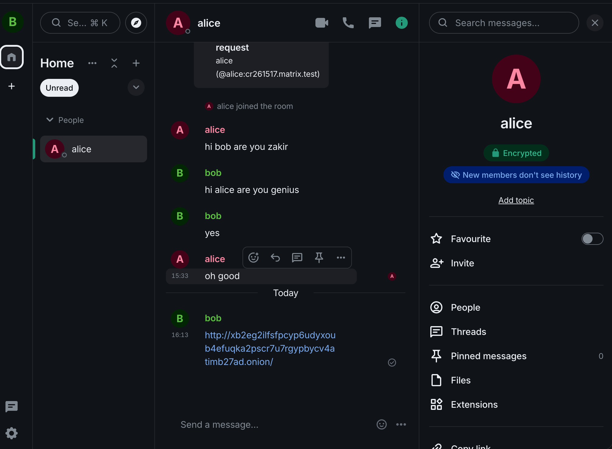

### Steps
1. `sh setup.sh` – generates `homeserver.yaml` + signing keys for both servers with `synapse generate`, applies the exercise settings, creates a self-signed certificate with SANs for both server names.
2. `docker compose up -d` – starts `hsA`, `hsB`, `federation-proxy`, `element`, `heisenbridge`.
3. Create users (shared-secret registration):

```bash
docker exec hsA register_new_matrix_user -u alice -p '<pw>' -a -c /data/homeserver.yaml http://localhost:8008
docker exec hsB register_new_matrix_user -u bob -p '<pw>' --no-admin -c /data/homeserver.yaml http://localhost:8008
```

4. Run `python3 test_federation.py` for the cross-server chat test below. For interactive use, open <http://localhost:8080> and log in as `@alice:cr261517.matrix.test`; for `bob` use "Edit" on the homeserver and `http://localhost:8009`.

### Configuration changes (`exercise_settings.yaml`, appended to `homeserver.yaml`)
```yaml
federation_verify_certificates: false      # lab only: self-signed certs
ip_range_whitelist: [172.16.0.0/12, 192.168.0.0/16, 10.0.0.0/8]   # allow federation to private Docker IPs
trusted_key_servers: []                    # no external key server in the lab

encryption_enabled_by_default_for_room_type: all   # enable encryption state for new rooms

retention:
  enabled: true
  default_policy:
    min_lifetime: 1d
    max_lifetime: 1y
  allowed_lifetime_min: 1d
  allowed_lifetime_max: 1y
```
Bridge (only on `hsA`):
```yaml
app_service_config_files:
  - /bridge/registration.yaml
```

## Pitfalls encountered
- **`.local` domain does not federate:** my first attempt used `*.matrix.local`. Synapse looks up the SRV record `_matrix-fed._tcp.<domain>`; for `.local` (mDNS) the resolver returned **SERVFAIL** instead of NXDOMAIN, so Synapse treated the server as unreachable (`502 Can't connect to server`, `DNSServerError rCode=2` in the log). Switching to the reserved TLD `.test` (clean NXDOMAIN → fallback to port 8448) fixed it. The UAS ID is still part of the name.
- **Private IPs are blocked by default:** Synapse refuses federation to RFC1918 addresses; `ip_range_whitelist` was needed for the Docker network.
- **Federation requires HTTPS:** Synapse only speaks TLS to other homeservers, so plain `8008` is not enough. nginx terminates TLS on 8448 (self-signed, therefore `federation_verify_certificates: false`; with a real domain use a Let's Encrypt cert and keep verification on).
- Docker Desktop was not running at first (`Cannot connect to the Docker daemon`).

## Result: working chatroom with two homeservers

Output of `python3 test_federation.py` (alice on `cr261517.matrix.test` creates a room, invites `bob` on `partner.matrix.test`):

```
room: !6C3RxfSHISHiUD9oSh3xXi2A-Jbx4f1qoyHateKO6XE
m.room.encryption state (default for new rooms): {'algorithm': 'm.megolm.v1.aes-sha2'}
bob (partner.matrix.test) joined
file uploaded: mxc://cr261517.matrix.test/frKTZVvzWoWFZgIkVaZCkEAI
members seen from partner server: ['@alice:cr261517.matrix.test', '@bob:partner.matrix.test']
  @bob:partner.matrix.test -> m.room.message hello back from partner.matrix.test
  @alice:cr261517.matrix.test -> m.room.message hello from cr261517.matrix.test
  @alice:cr261517.matrix.test -> m.room.message hello.txt
```

Interpretation:
- The room was created on server A, bob's server B accepted the invite and joined through the federation API (TLS on 8448); members from both servers are in the room → **federation works**.
- The new room automatically has `m.room.encryption` (`m.megolm.v1.aes-sha2`), demonstrating the default encryption state. The test script sends plaintext through the raw API and does **not** verify end-to-end encrypted messaging; an encryption-capable client test is still needed.
- The file uploaded to server A was downloaded by bob from **his own** server B (`curl .../_matrix/client/v1/media/download/cr261517.matrix.test/frKTZVvzWoWFZgIkVaZCkEAI` returned `file shared over federation`), i.e. B fetched the media from A over federation → **file sharing works**.
- Retention is configured as shown. Synapse applies its default policy when a room has no policy; the allowed limits adjust the effective `max_lifetime` used by purge jobs rather than preventing room admins from setting other values. Synapse records `min_lifetime` but does not otherwise implement it. Purges are asynchronous and do not cover state events. Actual expiration and deletion were not observed; see [Synapse retention documentation](https://matrix-org.github.io/synapse/latest/message_retention_policies.html).

### Remaining verification
The screenshot shows a two-user conversation and an encrypted-room indicator, but does not independently verify the message event types or show both full homeserver IDs. Audio/video was not tested. An independent partner and reachable LAN or public deployment are still required for the partner test.

## Bonus: bridge (Heisenbridge, Matrix ⇄ IRC)
1. `docker run --rm -v $PWD/bridge:/data hif1/heisenbridge -c /data/registration.yaml --generate -l heisenbridge -p 9898` creates the appservice registration (namespace `@irc_.*`).
2. Registration file mounted into `hsA` and listed in `app_service_config_files`; the `heisenbridge` container runs with owner `@alice:cr261517.matrix.test`.
3. Alice opened a DM with `@heisenbridge:cr261517.matrix.test` and sent `HELP`:

```text
@heisenbridge:cr261517.matrix.test : Howdy, stranger! You have been granted access to the IRC bridge of cr261517.matrix.test.
@heisenbridge:cr261517.matrix.test : Following commands are supported:
    NETWORKS - list available networks
    SERVERS  - list servers for a network
    OPEN     - open network for connecting
    STATUS   - show bridge status ...
```

The bridge responded. Connecting to an actual IRC network (`OPEN libera`) was not done here. A bridge must have access to the content it forwards, so end-to-end confidentiality does not extend across the IRC bridge.

## Moving to a real partner (LAN/WAN)
- Pick real names (e.g. `<uasid>.<your-domain>`) with DNS A records (or a `_matrix-fed._tcp` SRV record) pointing to the host; open TCP 8448 (or serve `/.well-known/matrix/server` on 443).
- Use a valid certificate (Let's Encrypt) and remove `federation_verify_certificates: false` and the IP whitelist.
- Check with the Matrix Federation Tester; then invite `@partner:their.domain` to a room.

## Cleanup
`docker compose down` (add `-v` not needed; data lives in `hsA/`, `hsB/`). Test credentials are lab-only.

---

# Exercise 8 – Tor onion service

[View Exercise 8 on GitHub](https://github.com/vivekkumar03/PRC/tree/main/exercise8)

**Task:** Create an onion service with Tor and access it (Hello World page); create a hidden service for the Matrix server; document it; which browser and why; show circuits for clearnet vs. hidden service and explain the difference; find news sites/public services with onion services.

## Setup (Docker, all files in this folder)

| Container | Role |
|---|---|
| `onion-web` | nginx serving `web/index.html` ("Hello World") |
| `tor-hs` | Tor daemon that publishes **two onion services** (v3) |
| `tor-client` | Separate Tor daemon acting as client: SOCKS proxy `127.0.0.1:9050` (published on the host loopback only) and control port for circuit inspection |

The Matrix homeserver `hsA` of exercise 7 is reached via the Docker network `exercise7_matrixnet`.

### Configuration (`tor-hs/torrc`)
```
DataDirectory /var/lib/tor/data
HiddenServiceDir /var/lib/tor/hs_hello
HiddenServiceVersion 3
HiddenServicePort 80 web:80

HiddenServiceDir /var/lib/tor/hs_matrix
HiddenServiceVersion 3
HiddenServicePort 80 hsA:8008
```
Client (`tor-client/torrc`): `SocksPort 0.0.0.0:9050`, `SocksPolicy accept *` (only published on the host's 127.0.0.1), `ControlPort 127.0.0.1:9051`, `CookieAuthentication 1`.

### Steps
```bash
cd exercise7 && docker compose up -d          # Matrix stack (network needed by tor-hs)
cd ../exercise8 && docker compose up -d --build
docker exec tor-hs cat /var/lib/tor/hs_hello/hostname /var/lib/tor/hs_matrix/hostname
```
Tor generates an ed25519 key pair per service; the `.onion` address *is* the public key (base32 + checksum + version), so no registration or DNS is needed:
- Hello World: `xb2eg2ilfsfpcyp6udyxoub4efuqka2pscr7u7rgypbycv4atimb27ad.onion`
- Matrix (client API): `ngxmra3rem5sy5x74kmwpcl25a3sjiyjqkotpzj5q3jaazntjsnatwyd.onion`

(Lab addresses; the private keys are in the Docker volume `hs_keys` and not part of the submission.)

## Result: accessing the services

Through the SOCKS proxy of the separate client (`--socks5-hostname` makes Tor resolve the name; a normal DNS lookup cannot resolve `.onion`):

```
$ curl --socks5-hostname 127.0.0.1:9050 http://xb2eg2ilfsfpcyp6udyxoub4efuqka2pscr7u7rgypbycv4atimb27ad.onion/
<h1>Hello World from a Tor onion service!</h1> ...

$ curl --socks5-hostname 127.0.0.1:9050 http://ngxmra3rem5sy5x74kmwpcl25a3sjiyjqkotpzj5q3jaazntjsnatwyd.onion/_matrix/client/versions
{"versions":["r0.0.1","r0.1.0","r0.2.0", ... "v1.1", ...
```
Both responded during the recorded test through Tor. Availability can change when the service or network is offline. The onion endpoints do not require a public DNS name or inbound port on this host. (For Matrix, a client such as Element must be pointed at this base URL; ordinary federation needs separate setup. Onion-to-onion federation was not tested.)

**Availability check, 14 November 2026:** both onion URLs timed out after 25 seconds through the local Tor proxy; a Firefox-through-Tor attempt also timed out. The Tor logs showed repeated clock jumps, but the cause of the failures was not established.

The uploaded screenshot below separately shows the Hello World onion page
open in Tor Browser. Availability can vary between attempts.


### Pitfalls
- The first bootstrap took several minutes in the container (directory info download: "Bootstrapped 45%" for a long time). Requests to a fresh onion service fail until the service descriptor has been uploaded to the HSDirs, so the first `curl` returned nothing; a retry after a few minutes worked.
- The hidden service container must be on the same Docker network as the target (`hsA`), hence the external network `exercise7_matrixnet`.

## Which browser?
**Tor Browser** is recommended: it routes browser traffic through Tor and includes defenses intended to reduce fingerprinting and cross-site tracking. These protections are not perfect and do not make all users indistinguishable. The original command-line test used `curl` with `--socks5-hostname`; the uploaded screenshots show Tor Browser visiting the Hello World and BBC onion sites.

Other browsers can be used if they are configured to use a Tor SOCKS proxy and to send DNS through it:
- **Firefox** (normal): proxy settings → SOCKS v5 `127.0.0.1:9050`, enable "Proxy DNS when using SOCKS v5" (`network.proxy.socks_remote_dns=true`), and set `network.dns.blockDotOnion=false`.
- **Brave**: "Private window with Tor" (built-in Tor).
- **Chrome/Chromium**: `--proxy-server="socks5://127.0.0.1:9050"`.
But a normal browser is easily fingerprinted/identified (extensions, fonts, WebRTC/DNS leaks, cookies), which undermines the anonymity gained by Tor, so only Tor Browser is advisable for real anonymity.

## Circuits: clearnet vs. hidden service

The following uploaded screenshots show two different circuits to the BBC
onion site. Both are onion-service circuits, **not** a clearnet-versus-onion
comparison; the circuit display indicates the onion site's relay side.


Script `circuits.sh` (output saved in `circuits_output.txt`) reads `GETINFO circuit-status` from the control port after each request. The general circuits below are visible at that time, but the output does not establish which one carried the clearnet request.

**Clearnet** (`https://check.torproject.org/api/ip` → `{"IsTor":true,"IP":"109.70.100.1"}`), observed general circuits:
```
45 BUILT olivia, kingray, NTH43R2          PURPOSE=GENERAL
46 BUILT as215248tor2a, TheLoneGunmen, lunar9   PURPOSE=GENERAL
```
**Hidden service** (Hello World), purpose `HS_CLIENT_REND` (rendezvous circuit, flag `IS_INTERNAL`, `HS_STATE=HSCR_JOINED`) and `HS_CLIENT_HSDIR` (descriptor lookup):
```
43 BUILT as215248tor2a, evers, NTH161R1                    PURPOSE=HS_CLIENT_REND  HS_STATE=HSCR_JOINED REND_QUERY=xb2eg2il...
33 BUILT as215248tor2a, evers, FloTheDev, p1onX01           PURPOSE=HS_CLIENT_HSDIR
```
Why they differ:
- **Clearnet:** a connection to an ordinary internet site uses an *exit relay*. The exit sees the destination and can see plaintext without HTTPS; the destination sees the exit IP. Tor is designed so that no single relay knows both the client and destination, but traffic analysis remains a risk.
- **Onion service:** no clearnet exit is used. The client obtains a descriptor from HSDirs and contacts an introduction point; client and service then connect through a rendezvous point using separate circuits. The exact circuit lengths vary; the shown rendezvous circuit is the client side. Onion connections provide encryption and authentication for the onion address, but do not guarantee anonymity or immunity from attacks.
- Costs: higher latency (more hops, descriptor lookup, rendezvous setup); this is why the first request was slow.

## Onion services of news sites and public services

Results recorded through the Tor client at the time (`onion_sites.txt`); these addresses and availability may have changed:

| Service | Onion address | Result |
|---|---|---|
| BBC News | `bbcnewsd73hkzno2ini43t4gblxvycyac5aw4gnv7t2rccijh7745uqd.onion` | 301 (redirect, reachable) |
| DuckDuckGo | `duckduckgogg42xjoc72x3sjasowoarfbgcmvfimaftt6twagswzczad.onion` | 200 |
| Proton Mail | `protonmailrmez3lotccipshtkleegetolb73fuirgj7r4o4vfu7ozyd.onion` | 200 |
| New York Times | `nytimesn7cgmftshazwhfgzm37qxb44r64ytbb2dj3x62d2lljsciiyd.onion` | timeout in my test; current availability unverified |
| Tor Project | `2gzyxa5ihm7nsggfxnu52rck2vv4rvmdlkiu3zzui5du4xyclen53wid.onion` | timeout in my test |

Reasons for onion services include reaching users in censoring countries, protecting readers' privacy, avoiding exit-node interception and enabling source contact. Check addresses against each provider's official site before using them.

## Remaining verification
The uploaded screenshots show Tor Browser accessing the Hello World and BBC onion pages and displaying BBC onion circuits. A clearnet circuit screenshot and a request-specific clearnet-versus-onion comparison remain outstanding; the Matrix onion API was not shown in these screenshots.

## Cleanup
`docker compose down` stops the services. Retain the onion-key volume to keep the same addresses.

---

# Exercise 9 – I2P Email and OpenPGP

[View Exercise 9 on GitHub](https://github.com/vivekkumar03/PRC/tree/main/exercise9)

**Privacy and Cryptography · 15 November 2026**

## Objective

Create I2P email accounts and OpenPGP keys, send an encrypted onion-service
address to a recipient, and open it using Tor Browser. The two email
identities were `vivek@mail.i2p` and `zakir@mail.i2p`.

## Setup

The I2P router provided the Postman email tunnels: SMTP on local port `7659`
and POP3 on `7660`. The I2P HTTP proxy used local port `4444`. These services
were kept on the local machine.

I created the two mailboxes on Postman HQ through the I2P HTTP proxy. The
confirmation pages show the resulting `vivek@mail.i2p` and `zakir@mail.i2p`
addresses. Passwords are redacted from these screenshots.

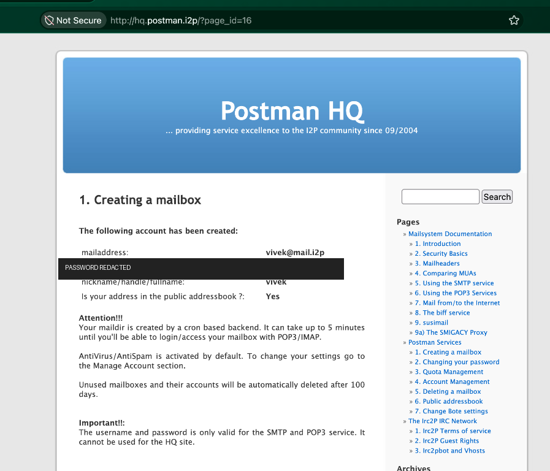


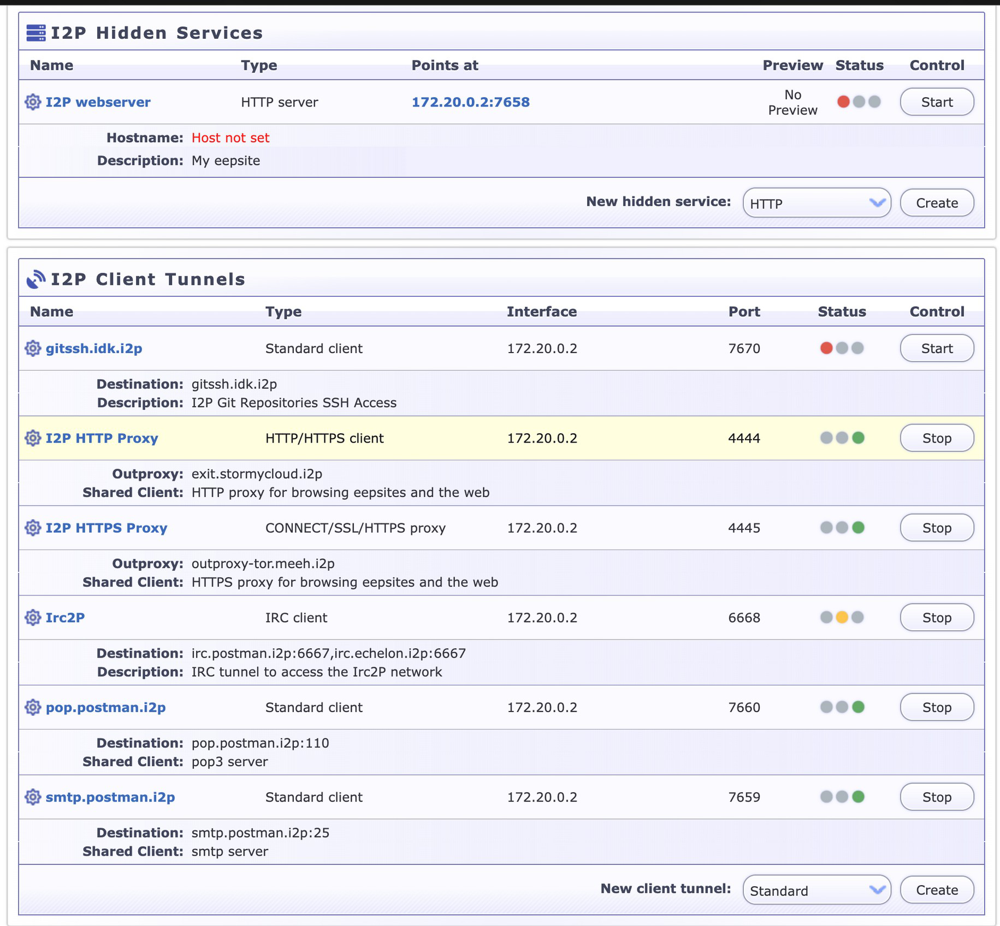


Separate OpenPGP key pairs were created for the two email identities. The
keychain screenshot shows both keys.

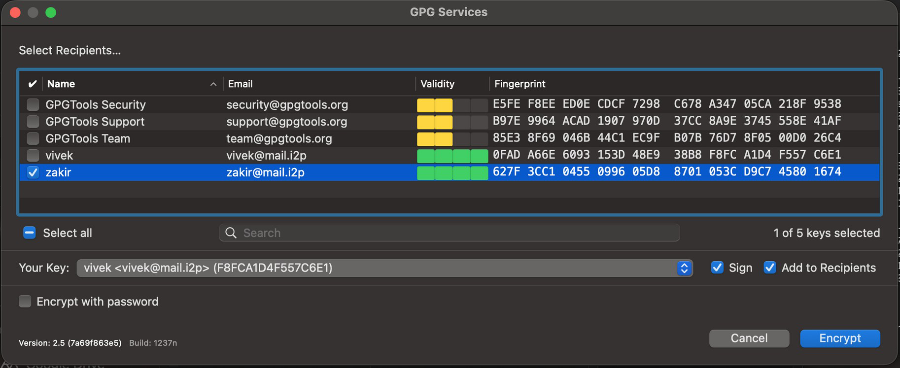

I uploaded the exported public key to [keys.openpgp.org](https://keys.openpgp.org/).
Only the public key is published; the private key stays in the local keychain.
The I2P email screenshots show the armored encrypted onion-address message,
not an attached `.asc` public-key file. The key publication and the encrypted
email exchange were separate steps.

## Sending, encryption, and decryption

Thunderbird was tried but did not work for this email workflow. I then used
GPGTools/GnuPG manually to encrypt and sign the onion address for the
recipient, and to decrypt and verify it. GnuPG reported a **good signature
from Zakir's key**. The resulting armored OpenPGP message was sent through
SusiMail.

The sender's Sent-folder screenshot shows the encrypted message addressed to
Zakir. The recipient-side screenshots show Zakir's SusiMail account and the
opened message from Vivek containing the armored PGP message.

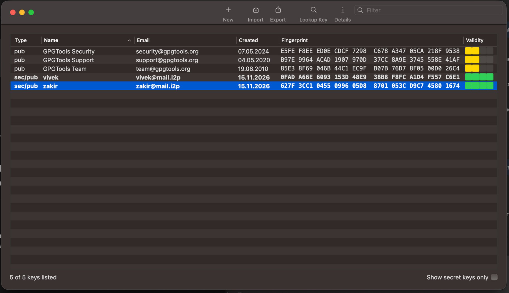

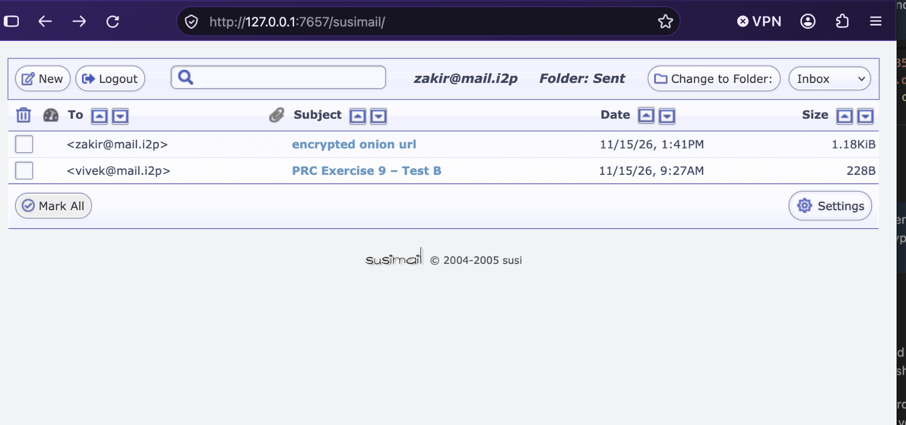

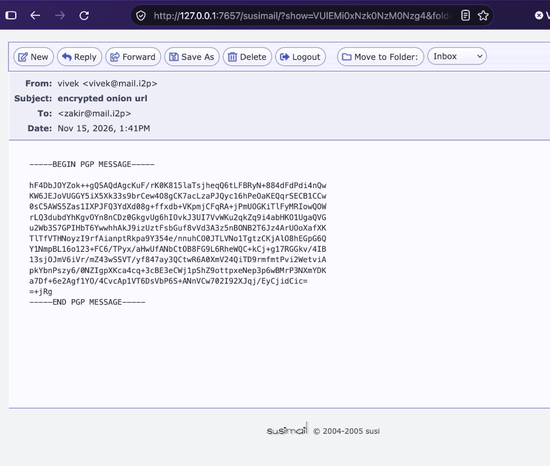

## Opening the onion service

After decryption, Tor Browser opened the onion service, displaying the
“Hello Onion” page. The screenshot includes the onion address and Tor relay
IP addresses. The relay details describe this captured session and may change
with a different circuit.

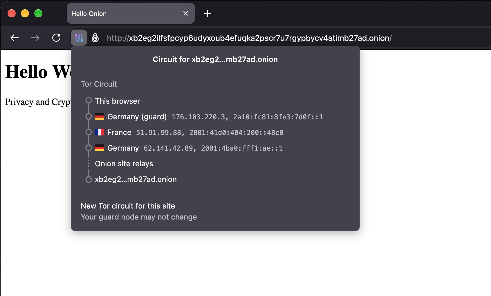

## Results and learning

- I2P provided the email transport; Tor Browser accessed the onion service.
  These are separate networks with different purposes.
- OpenPGP encrypts message content and allows signature verification. GnuPG
  reported a good signature associated with Zakir's key.
- OpenPGP does **not** hide ordinary email headers such as sender, recipient,
  date, or subject. The subject can reveal the message's purpose, so avoid
  sensitive details there.
- Publishing a public key to multiple keyservers is not required if the
  recipient can obtain it reliably. Multiple servers may improve
  discoverability, but fingerprint verification through a trusted channel
  is still needed to confirm whose key it is.

## Sources

- [I2P Docker image](https://hub.docker.com/r/geti2p/i2p)
- [I2P browser configuration](https://i2p.net/en/docs/guides/browser-config/)
- [OpenPGP key publication guidance](https://keys.openpgp.org/about/usage/)

---

# Exercise 10: I2P Torrenting and Privacy

[View Exercise 10 on GitHub](https://github.com/vivekkumar03/PRC/tree/main/exercise10)

**Privacy and Cryptography · 15 November 2026**

## Objective

Transfer a small test file from the Exercise 9 publisher to the Exercise 10 recipient through the I2P torrent workflow, using I2PSnark and the Postman tracker. Confirm the received bytes by comparing SHA-256 digests, then relate the exercise to the privacy properties and limitations of I2P, Tor, and BitTorrent.

## Environment and setup

The publisher file was created in the Exercise 9 container. The publisher and recipient I2PSnark interfaces used separate host ports.

| Component | Observed / used |
|---|---|
| Publisher | Exercise 9 I2P container: `exercise9-i2p-1`; I2PSnark at `http://127.0.0.1:7657/i2psnark/`. |
| Recipient | Second local Docker container used as the Exercise 10 recipient: `exercise10-recipient-1`; I2PSnark at `http://127.0.0.1:7658/i2psnark/`. The Exercise 9 publisher was a separate local container. |
| Tracker | Postman I2P tracker at `tracker2.postman.i2p`, opened in the I2P-enabled browser. The torrent was submitted through the tracker's web upload. |
| Data file | `prc-exercise10-network-transfer.txt`, 260 bytes, stored under `/i2psnark/` in the publisher and recipient containers. |
| Torrent identifier | Infohash `B033C284BB025181DF8007CBA3880EB1F0EC399A`. |
| Local tools | Docker commands were run from the host terminal to inspect the containers and calculate SHA-256. |

## Practical workflow

### Publisher: Exercise 9

1. Created `prc-exercise10-network-transfer.txt` in the publisher container under `/i2psnark/`. The recorded content identifies it as a new test file intended for the recipient to obtain through the I2P torrent network; its size was 260 bytes.
2. Opened the Exercise 9 I2PSnark interface on port 7657 and used **Create Torrent** with `/i2psnark/prc-exercise10-network-transfer.txt`. The first form submissions produced “bad nonce” messages; after refreshing and retrying, the torrent metadata was created. This was an observed setup pitfall, not evidence of a transfer failure.
3. Copied the generated `.torrent` metadata file from the container to the host for tracker registration. The recorded command was:

   ```bash
   docker cp exercise9-i2p-1:/i2psnark/prc-exercise10-network-transfer.txt.torrent ~/USTP/PRC/exercise10/transfer-test/
   ```

4. Uploaded the `.torrent` metadata to Postman before starting the new torrent. The registration detail showed name `prc-exercise10-network-transfer`, owner `vivekkumar`, size 260 Bytes, upload method Web upload, and infohash `B033C284BB025181DF8007CBA3880EB1F0EC399A`. At registration the tracker listed 0 seeders and 0 leechers.
5. Returned to Exercise 9 I2PSnark and started the new torrent so the publisher could seed it. The interface listed the 260-byte transfer torrent alongside an earlier 111-byte example torrent. The screenshot recorded 0 connected peers; this is consistent with no currently connected peer being shown, not proof that the swarm was unavailable.

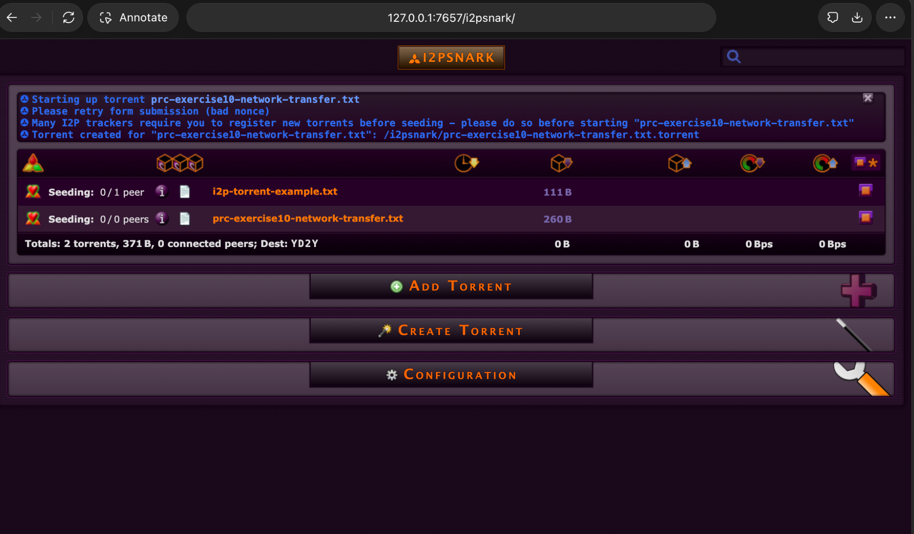

*Figure 1. Exercise 9 I2PSnark lists the 260-byte torrent. The interface shows 0 connected peers in this capture.*

### Recipient: Exercise 10

6. Opened the registered Postman detail page for `prc-exercise10-network-transfer` and copied its magnet link.
7. Opened the Exercise 10 I2PSnark interface on port 7658. Chose **Add Torrent**, pasted the magnet link, and submitted it. The recipient then displayed the matching torrent name and infohash.
8. Allowed I2PSnark to process the torrent. The interface ultimately displayed “Download finished” for `prc-exercise10-network-transfer.txt` and showed a size of 260 B.
9. Inspected the recipient file and compared its SHA-256 digest with the publisher copy.

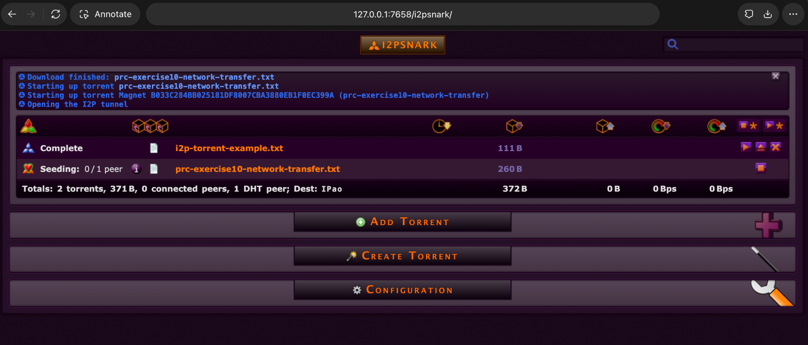

*Figure 2. Exercise 10 I2PSnark reports “Download finished” for the 260-byte file. The capture shows 0 connected peers and 1 DHT peer.*

## Host terminal verification

The recipient file was listed as 260 bytes. The recorded commands were:

```bash
docker exec exercise10-recipient-1 ls -lh /i2psnark/prc-exercise10-network-transfer.txt
docker exec exercise10-recipient-1 sha256sum /i2psnark/prc-exercise10-network-transfer.txt
docker exec exercise9-i2p-1 sha256sum /i2psnark/prc-exercise10-network-transfer.txt
```

Both files had the SHA-256 digest:

```text
dd47b346b3ec0a9f9dd16f2b4a5211352cd4d229b58e3b9275a7ff1fcfd203c6
```

A matching SHA-256 digest is strong evidence that both local files contain identical bytes, subject to the usual negligible collision probability. Combined with the recipient’s “Download finished” status, this supports successful completion of the transfer workflow. It does not identify the exact relay or peer path, independently authenticate the publisher, or prove that the tracker supplied content.

| Check | Observed result |
|---|---|
| Recipient file size | 260 bytes (`260` in `ls -lh`; I2PSnark displayed 260 B). |
| Recipient SHA-256 | Matches the publisher's digest. |
| Publisher SHA-256 | Matches the recipient's digest. |

## Observed results and evidence boundaries

The observed 0-peer count is a momentary interface view and does not exclude a brief earlier peer exchange, another routing state, or data obtained through a path not exposed by the screenshot. Conversely, “Download finished” and matching file hashes do not reveal that path. The most defensible result is content-level completion supported by the client status and independent local hash comparison, with network-path details unresolved.

| Statement | Evidence status |
|---|---|
| Postman registration: owner `vivekkumar`, infohash `B033C284BB025181DF8007CBA3880EB1F0EC399A`, size 260 bytes. | Directly shown in the registration detail evidence. |
| Recipient I2PSnark displayed “Download finished” for the 260-byte torrent. | Directly shown in the recipient interface evidence. |
| Publisher and recipient SHA-256 values matched. | Reported from terminal commands on both containers. |
| Recipient I2P router was fully ready / network status was OK. | Not demonstrated. The recipient showed **Network: Testing**. |
| A direct publisher-to-recipient peer connection was observed. | Not demonstrated. Relevant screenshots showed **0 connected peers / 1 DHT peer**. |
| The completed file came from a particular peer or route. | Not established by the available interface and checksum evidence. |

## Limitations and caveats

- A file hash checks byte equality, not authorship or safety. Without a trusted signature or independently verified publisher key, a matching file could still be consistently wrong or malicious.
- Tracker registration records torrent metadata and swarm information; it is not a content-integrity authority and does not itself prove that the tracker relayed the file.
- I2PSnark peer and DHT counts are snapshots. A screenshot cannot establish all transient connections during a transfer.
- “Network: Testing” means the recipient router had not shown a confirmed ready status in the captured view. The transfer result should not be used to claim the router was fully healthy or that all I2P connectivity checks passed.
- The sample is only 260 bytes. It verifies a small-file workflow, not throughput, scalability, robustness under interruption, or resistance to traffic analysis.
- The first 111-byte `i2p-torrent-example.txt` was an initial workflow test and is not the primary Exercise 10 result. The 260-byte file and its infohash are the final transfer evidence.

## How does an I2P torrent differ from a clearnet torrent?

The BitTorrent concepts remain similar: a torrent identifies content and peer availability is discovered through tracker and/or DHT mechanisms. The main difference is the network on which discovery and peer communication take place. A clearnet torrent uses ordinary Internet addresses and public Internet reachability; a torrent client can expose a user’s IP address to other peers and possibly to trackers. An I2P torrent uses I2P destinations and I2P transport, so participating clients communicate within the I2P overlay rather than through publicly routable peer IP addresses. The Postman tracker used here is an I2P service, and the magnet metadata identifies the torrent through its infohash while I2PSnark locates peers in its configured I2P environment.

I2P provides layered routing within its own network and is designed primarily for services and communication inside that overlay. This brings a different address model, peer population, reachability, and performance profile from clearnet BitTorrent. I2P does not automatically make the user anonymous against every observer: endpoints, timing, volume, application behavior, misconfiguration, malicious peers, and correlation remain relevant. A clearnet torrent does not become an I2P torrent merely because the same BitTorrent protocol is used; the peer and tracker paths must actually use I2P.

## Can BitTorrent run over Tor? Why is it discouraged or difficult?

BitTorrent can be configured to use Tor in some client and network arrangements, but ordinary peer-to-peer torrenting is a poor fit for Tor. Many BitTorrent clients use UDP for DHT, peer discovery, and transport features, while Tor’s standard circuits carry TCP streams. Tor does not provide general UDP forwarding, so clients may fall back to direct connections or lose important discovery features unless carefully configured. If any tracker, DHT, peer, or auxiliary connection escapes the Tor path, the user’s public IP can be exposed. Peer-to-peer traffic also creates many long-lived, high-volume connections; this can consume scarce Tor capacity and make timing/volume correlation easier. Exit nodes may see unencrypted traffic when the application layer does not encrypt it, and a Tor exit is not a general shield against malicious content or identity leakage.

Tor is a low-latency anonymity network designed to support interactive TCP applications and access to both onion services and the clearnet. Routing a bulk P2P swarm through Tor can burden the network and offers weaker guarantees than users often assume. A user who chooses to experiment must bind the client to the intended proxy/interface, disable paths that bypass it, understand UDP limitations, avoid exposing a real IP through DHT or tracker connections, and check the client’s behavior. The safer course is to avoid using public Tor exit paths for BitTorrent; use a network designed for internal P2P traffic or a properly configured privacy solution whose policies and limitations are understood.

## What privacy and anonymity risks remain?

Anonymity is not a single property guaranteed by encryption. In torrenting, the infohash, tracker queries, peer lists, connection timing, transfer volume, and a distinctive download can reveal interests or link activity over time. A tracker can log registrations and announces; peers can observe the destination identity or address visible within their network. In I2P, the overlay obscures ordinary IP addresses from peers but does not prevent correlation by a sufficiently capable observer, malicious or compromised infrastructure, application-level identifiers, or a user who accidentally downloads through clearnet.

Other risks include reused usernames, account logins, browser cookies, file metadata, identifying text embedded in a shared file, unsafe client configuration, DNS or proxy leaks, compromised endpoints, malware, and traffic analysis. Encryption protects content in transit only for the layers and links where it is applied; it does not hide all metadata. Small swarms and rare files can be more identifying because fewer users share the same activity. Privacy therefore depends on the whole setup and behavior, not merely selecting an I2P or Tor option.

## When are torrents useful for legal distribution?

Torrents are useful for distributing large, legitimate files to many recipients without requiring one central server to supply every byte. Examples include Linux and other operating-system images, public-domain or openly licensed media, research datasets, and software released by its publisher. Peer-assisted distribution can reduce the origin server’s bandwidth load and improve availability when many users participate. The Exercise 10 test applies the same basic distribution model to a small text file.

For software updates and OS images, users should obtain torrent links from the official publisher, verify signed checksums or signatures published through a trusted channel, and verify the file after downloading. A torrent’s internal piece hashes detect accidental corruption relative to the torrent metadata, but do not prove who created that metadata. HTTPS, signed release manifests, and publisher signatures help establish authenticity; a standalone checksum copied from an untrusted source does not. Users should also respect copyright, license terms, and applicable law. The protocol is neutral: legality depends on the content and authorization to distribute it.

## What are the main differences between Tor and I2P?

Both use layered routing to make it harder for a single network point to associate a user with a destination, and neither is a guarantee of perfect anonymity. Their architecture and default network scope differ, so choosing between them depends on whether the goal is access to public Internet services, onion services, or services inside I2P.

| Aspect | Tor | I2P |
|---|---|---|
| Network purpose | Supports access to the public Internet through exit relays and access to onion services. | Primarily a self-contained overlay for communication and services within I2P. |
| Routing model | Onion routing through circuits, commonly with entry, middle, and exit relays for clearnet access. | Garlic routing and separate inbound/outbound tunnels, with traffic kept inside the overlay for I2P services. |
| Address/service model | Onion services use `.onion` names; clearnet browsing may exit to public sites. | I2P destinations and naming are used for internal services; reaching clearnet generally requires an outproxy. |
| Typical use distinction | Useful when an application needs private access to clearnet services or onion services. | Useful for services and peer communication intended to remain inside the I2P network. |
| Caveats | Exit traffic to clearnet can be observed at the exit if not protected end-to-end; application leaks remain possible. | Smaller overlay and service reachability can affect performance; correlation, endpoint, and configuration risks remain. |

## Evidence screenshots

The workflow captures are embedded in this report:

- **Publisher (Figure 1):** Exercise 9 I2PSnark lists the 260-byte torrent in a seeding state, with 0 connected peers visible in that capture.
- **Recipient (Figure 2):** Exercise 10 I2PSnark shows “Download finished,” 260 B, 0 connected peers, and 1 DHT peer.
- **Tracker (Figure 3):** Postman detail page shows the torrent name, owner `vivekkumar`, size 260 bytes, and registered infohash.
- **Terminal verification:** The recipient size and matching SHA-256 values are recorded above.

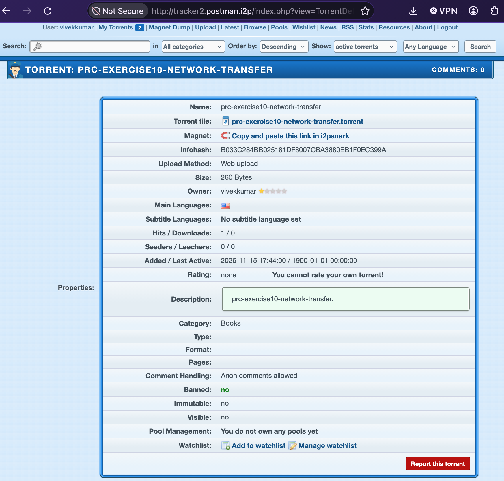

*Figure 3. Postman registration detail: infohash, 260-byte size, and owner `vivekkumar`.*

## Conclusion

The practical result is supported by two independent observations: Exercise 10 I2PSnark reported “Download finished,” and the publisher and recipient copies of the 260-byte file had identical SHA-256 digests. The torrent was registered on Postman under owner `vivekkumar` with infohash `B033C284BB025181DF8007CBA3880EB1F0EC399A`. These facts support successful completion and byte-for-byte equality.
---

# Exercise 11: Lightbeam and Privacy Badger

[View Exercise 11 on GitHub](https://github.com/vivekkumar03/PRC/tree/main/exercise11)

## Method

On 14 November 2026 I visited [BBC News](https://www.bbc.com/news) in a
temporary, isolated Firefox 160 profile controlled by Selenium. I temporarily
installed Lightbeam 3.4.9 from Mozilla Add-ons, loaded the page for 20 seconds,
and opened Lightbeam. I then used Lightbeam's **Reset Data** button and
confirmed that the counts returned to zero, installed Privacy Badger
2026.9.15 from Mozilla Add-ons, revisited the same URL for 20 seconds, and
opened Lightbeam again. I did not select either option on BBC's advertising
cookie prompt. Lightbeam displayed its Tracking Protection indicator as
**Off** in both screenshots; this is Lightbeam's indicator, not proof that
every browser privacy protection was disabled.


## Results

Lightbeam showed one visited website in both visits, and its **3rd Party
Requests** counter changed from **11 to 8**. These numbers describe its
visualized third-party hosts, not necessarily the total number of individual
HTTP requests. The following hostnames were retrieved from Lightbeam's recorded
website data, not inferred from the picture.

| Observed host | Lightbeam only | With Privacy Badger |
|---|---|---|
| `cdn.privacy-mgmt.com` | Yes | Yes |
| `cdn.tinypass.com` | Yes | Yes |
| `emp.bbci.co.uk` | Yes | Yes |
| `gn-web-assets.api.bbc.com` | Yes | Yes |
| `ichef.bbci.co.uk` | Yes | No |
| `mybbc-analytics.files.bbci.co.uk` | Yes | Yes |
| `rm-script.dotmetrics.net` | Yes | No |
| `static.bbci.co.uk` | Yes | Yes |
| `static.files.bbci.co.uk` | Yes | Yes |
| `uk-script.dotmetrics.net` | Yes | No |
| `www.bbc.co.uk` | Yes | Yes |

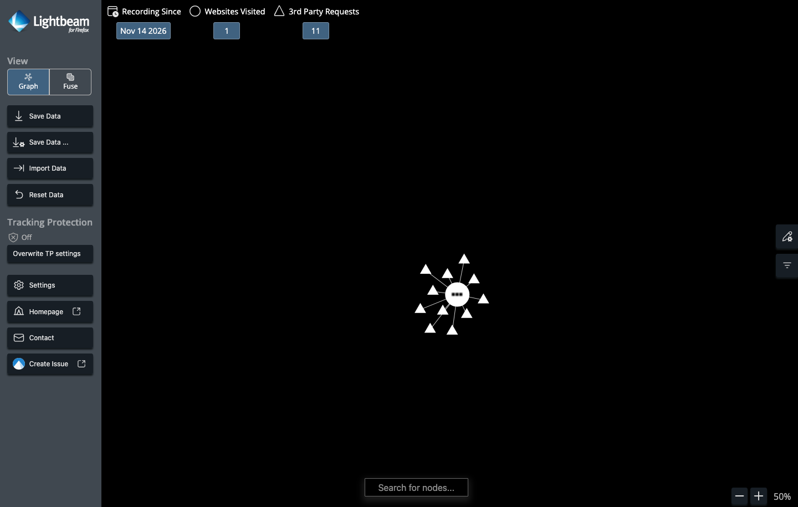

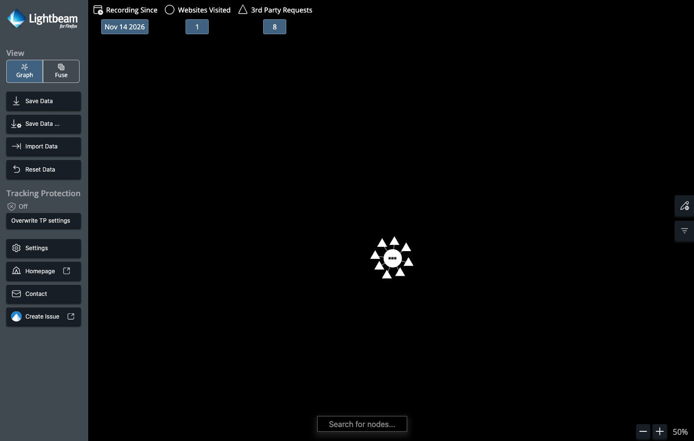

The analytics- and measurement-looking hostnames are possible tracking
surfaces, but Lightbeam's graph shows connections, not proof that a particular
host tracked this person or set an identifying cookie. BBC-related asset
hosts can be classified as third-party relative to `www.bbc.com` without
being independent tracking companies. The observed difference is three fewer
hosts, including two Dotmetrics script hosts, not proof that Privacy Badger
blocked exactly those hosts: the test did not inspect its block decisions.

The same browser profile was reused after resetting Lightbeam, but browser
cache and cookies were not cleared. Dynamic site content, consent state,
network timing and Privacy Badger's pre-trained rules may affect the result.
One visit per condition cannot establish causation; repeat with controlled
fresh profiles and inspect Privacy Badger's per-site decisions for a stronger
comparison. Privacy Badger's learning updates and optional local learning
are described in its [FAQ](https://privacybadger.org/).

## Sources

- [Lightbeam for Firefox](https://addons.mozilla.org/en-US/firefox/addon/lightbeam-chikl/)
- [Privacy Badger for Firefox](https://addons.mozilla.org/en-US/firefox/addon/privacy-badger17/)
- [Privacy Badger FAQ](https://privacybadger.org/)
